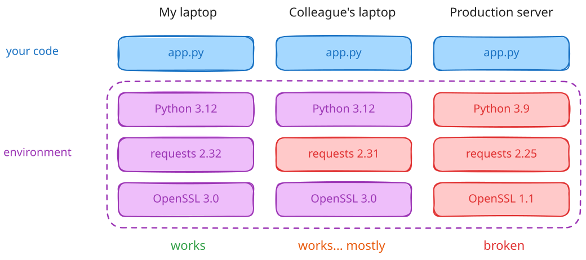
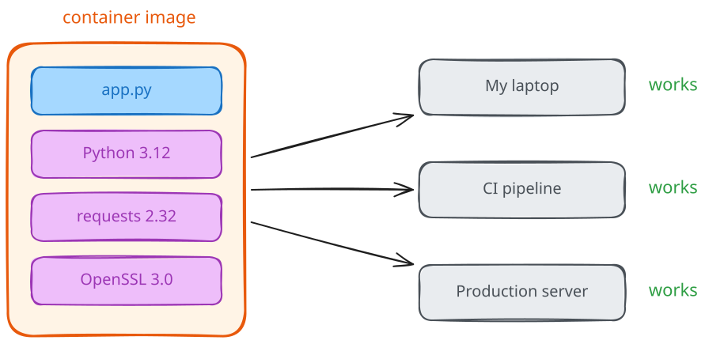
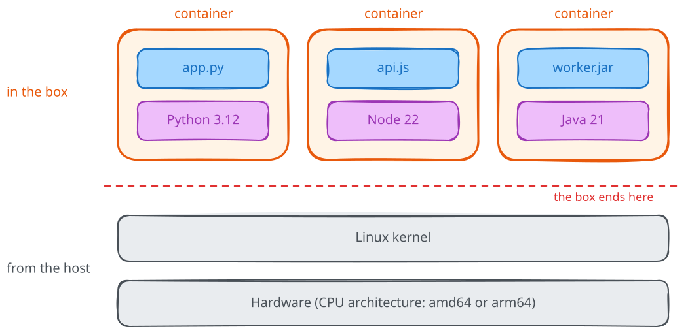

# The problem containers solve

"It works on my machine." I bet you've said it at least once, or you've heard a colleague say it right after a deploy went wrong. And you probably also know how that conversation ends: nobody really knows why it doesn't work on the server, and someone spends the afternoon comparing versions of things.

By the end of this chapter, you will know where that problem comes from, why containers were invented to solve it, and what a container actually is.

Beware, though, here we only set up the problem. Next, we'll get a small application running and try changing it, without waiting to learn every mechanism underneath. Then we'll come back to the history and the Linux kernel with something concrete to explain.

## Your application is more than your code

So, first of all, let's look at what you are really running when you start an application.

You have your code, sure. But your code needs a runtime, like Python or Node, in a specific version. It needs the libraries you listed in your `requirements.txt` or `package.json`, and those libraries have their own dependencies. Some of them rely on system libraries, like OpenSSL or `libpq`, that you installed months ago and forgot about. And then there are environment variables, config files, paths that exist only on your laptop.

All of this is the **environment** of your application, and your code doesn't work without it.

The thing is, every machine has its own environment. Your laptop has one, your colleague's laptop has a slightly different one, and the production server has the one that someone configured two years ago. Over time they drift apart, one update at a time, without anyone deciding it.

> 💡 **Environment drift**: the slow divergence between the environments where the same software runs.

So when something works on your machine and not on the server, most of the time the bug is not in your code. It's in the difference between the two environments.

## Put everything in a box

The idea behind containers is pretty simple: if the problem is that the environment changes from machine to machine, let's stop depending on the machine and ship the environment together with the code.

Think of it as a box. You put your application inside, together with everything it needs to run: the runtime, the libraries, the configuration. Then you close the box, and from now on, wherever you take it, what's inside stays the same.

The name is not a coincidence. Before shipping containers became a standard, goods were loaded onto ships one by one, and every ship, train, and truck had its own way of handling them. Once everyone agreed on a standard box, nobody needed to care about what was inside anymore: a crane lifts a container the same way whether it carries bananas or TVs.

Software containers work the same way. The box has a standard format (today it's defined by the [Open Container Initiative](https://opencontainers.org/), but we'll get there), so your laptop, a CI pipeline, or a cloud provider can all run it without knowing what's inside.

## So, what is a container?

Let's give it a proper definition:

> 💡 A container is a process running on a Linux host, packaged with its own filesystem and dependencies, and isolated from the other processes on the same machine.

The three keywords here are **process**, **packaged**, and **isolated**.

A container is a **process**, just like your shell or your browser. It's not a separate machine, and it runs on the same kernel as everything else on the host.

It's **packaged**: the process brings its own filesystem, with everything inside the box. This is the part that solves the "works on my machine" problem.

And it's **isolated**: the process has its own view of the system, with its own list of processes, its own network, its own hostname, and a limited share of CPU and memory. From the inside, it looks like it's alone on the machine.

## What do we get out of it?

Once the environment travels together with the application, a few nice things follow:

- **Reproducibility**: the same box runs the same way on your laptop, in CI, and in production;
- **No dependency conflicts**: two applications that need different versions of Python can run side by side on the same host, each in its own box;
- **Density**: containers share the host kernel, so you can run a lot more of them on a single machine compared to virtual machines;
- **Speed**: starting a container means starting a process, so it takes seconds, not minutes;
- **A common contract**: developers hand over a box, operations run the box. No more 40-step installation guides on a wiki.

And now for the downsides. All containers on a host share the same kernel, so the isolation is weaker than with a virtual machine, and that's why we'll have a whole module on security. Containers are also a Linux thing: on macOS and Windows, Docker runs a small Linux virtual machine behind the scenes. And they don't magically solve the problem of data: a container is meant to be thrown away and recreated, your database is not.

There's a catch, though. The box contains everything above the kernel, but not the kernel itself: that one always comes from the host. The box is also built for a specific CPU architecture, so an image for an Intel server is not the same as the one your Apple Silicon laptop pulls. And a Dockerfile is a recipe, not a box: two people building it on different days can end up with different results. So the promise is more precisely: **the same image, on a compatible kernel and architecture, behaves the same way.** We'll dig into each of these in the next modules.

## Common misconceptions

The most common one I hear is that **a container is a lightweight virtual machine**. It's not, and it's worth getting this right from day one. A virtual machine emulates hardware and boots its own kernel; a container is a process on the host kernel that can only see a part of the system. In module 02, you'll build one by hand without Docker at all, and it will be much clearer.

Another one is that **containers are Docker**. Docker made containers popular, but it didn't invent them, and today it's one tool among many. In this course, we'll run the same containers with both **Docker** and **containerd**.

The last one is that **with containers, you don't have to care about the environment anymore**. You still do, but you describe it once, in a file that lives next to your code and is versioned with it. And that's a lot better than a wiki page nobody updates.

## Recap

So, to sum up: your application is your code plus its environment, and environments tend to drift apart from machine to machine. Containers solve this by putting the application and its environment in the same box, a box with a standard format that can run anywhere. Under the hood, **a container is just a packaged and isolated process that shares the kernel with the host**.

Next, [set up one Docker environment](02-installing-docker-and-containerd.md), then [run your first application](03-your-first-application.md). You don't need to understand every part of the configuration before trying it; we'll use the result to give those details a purpose.
