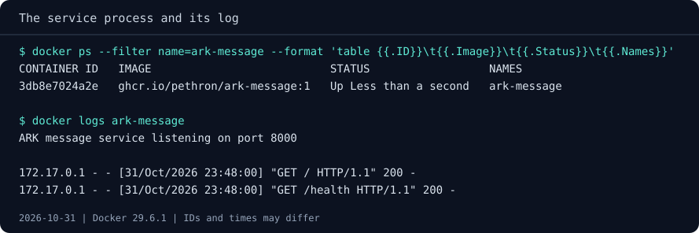

# Running your first container

You need to hand a colleague a small HTTP service. They should be able to start
it, choose the message it returns, and tell whether it is working, without
installing Python on their laptop.

Over this chapter and the next two, we'll get the service running, change its
configuration and investigate a connection failure. Here we start it and check
it from three angles: the response it sends, the process Docker keeps running
and the log the application writes. The service comes packaged in an image we
publish for the course, so you don't need to write Python or build anything
before trying it, and we'll use `docker run` throughout.

## Start the application

If you haven't yet, follow [Before you start](../before-you-start.md) to install
Docker. You also need a browser or `curl`. You do not need Compose, a cloud
account or local Python, and this module doesn't use the course files either:
everything the service needs travels inside its image.

On Linux Engine, prefix Docker commands with `sudo` if required by your setup,
as explained in [Before you start](../before-you-start.md#linux-docker-engine).
Where Bash and PowerShell 7 differ, the commands come in tabs; the ones in
this chapter are the same in both shells.

Check `docker ps -a` for existing containers named `ark-message` or
`ark-second-message`. Docker will report an error if a host port is already
in use; if that happens, change the host-side `-p` value to a free loopback
port and update the URL too.

Here's what we're asking Docker to do: download the course's message service
image, which already contains Python and the application, start it in the
background under the name `ark-message`, and make it reachable only from this
machine at `http://127.0.0.1:8080/`.

```text
docker run -d --name ark-message -p 127.0.0.1:8080:8000 ghcr.io/pethron/ark-message:1
```

Docker prints the new container's identifier. On the first run, it also
downloads the image from GitHub's container registry. That identifier is not
proof that the service can answer a request; let's try it.

Open `http://127.0.0.1:8080/` in your browser. You should see JSON with these fields:

```json
{"message": "Hello from ARK", "served_by": "<this container's hostname>"}
```

The hostname value will differ from the example. You've now reached a Python
service without installing Python locally. If the page is not ready yet, wait
a moment and retry. If it still fails, use the process and log checks below
before continuing.

Also visit `http://127.0.0.1:8080/health`. Its response should be:

```json
{"status": "ok"}
```

This is a route supplied by our application, not an automatic Docker check.
It gives us a simple response to verify when we change the service later.

??? note "Prefer a terminal check? Use curl"

    ```text
    curl http://127.0.0.1:8080/
    ```

    If the service is still starting, wait a moment and try again.
    Replace the final URL with `http://127.0.0.1:8080/health` to check that route.

??? note "Using a remote Docker engine?"

    On Docker Desktop, the browser can run on your laptop. With a remote engine
    or a separate Linux VM, `127.0.0.1` refers to that Docker host, not your
    laptop. Run the terminal check on that host or use an SSH tunnel to reach
    it from your browser. You don't need to publish the port to the whole network.

### Is the process still running?

The page shows the service can respond. Now let's see what Docker can tell us
about the process behind it:

```text
docker ps --filter name=ark-message
```

Look for `ark-message` with an `Up` status. `docker ps` lists running
containers; the filter narrows the list to names containing `ark-message`.
An `Up` status tells us the main process is running, not that it can answer HTTP.
If the row is missing, include stopped containers with:

```text
docker ps -a --filter name=ark-message
```

Here `-a` means all states. If the service has exited, the next check helps us
find out why.

### What does the application say?

Read the output written by our application, even if the container has stopped:

```text
docker logs ark-message
```

You should find this startup message, followed by any requests you've made:

```text
ARK message service listening on port 8000
```

That's the application's own message, not Docker's assessment of its health.
Notice port 8000: it differs from the 8080 in our browser URL. We'll connect
those two numbers when we read the launch command in the next chapter. If you
see an error instead, investigate it before changing the service.

You now have three pieces of evidence about the same service, and each answers
a different question. The browser tells you the service can respond, `docker ps`
tells you its main process is running, and the log tells you what the
application itself reported when it started. Keep them apart: when something
goes wrong later, knowing which one changed is most of the diagnosis.



!!! success "Checkpoint"

    `ark-message` is running, and `http://127.0.0.1:8080/` answers with
    `"Hello from ARK"`. `docker ps` shows the container as `Up`, and its log
    starts with `ARK message service listening on port 8000`.
    Leave the container running: the [next chapter](04-make-it-yours.md)
    starts from it.

## If something fails

| Symptom | Next useful evidence |
|---------|----------------------|
| Docker cannot reach its server | Return to the [installation checks](../before-you-start.md#check-the-installation) |
| Image download fails | Read the registry error: connectivity, proxy settings, rate limits, and platform support are different causes |
| A container name is already in use | Inspect that named instance before deciding whether to reuse or remove it |
| Service exits before responding | Inspect `docker ps -a` and `docker logs` for your instance |
| Host port 8080 is already allocated | Use a free loopback host port, update the URL, and keep the container-side port at 8000 |
| Unknown URL returns 404 | Try `/` or `/health`; an HTTP response is different evidence from a connection failure |
