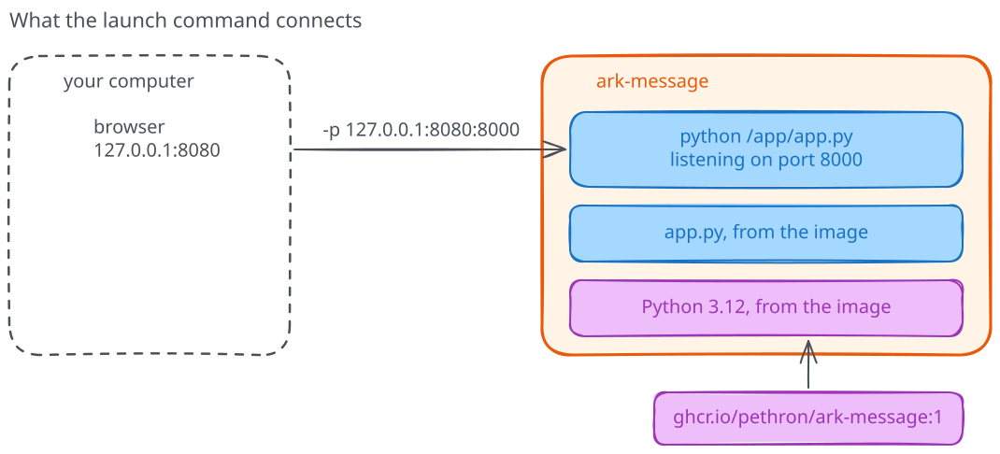

# Ports and environment variables

Your `ark-message` container is still answering on `http://127.0.0.1:8080/`
with the default message. Before asking the service to say something else,
let's go back to the command that started it. It was short, but each part of it
made a decision for us, and now that you've seen the result we can give each
one a purpose. There's no need to memorize the command.

## Read the launch command

Here's the whole arrangement first. The image brings Python and the application
together, and a request travels from the browser to the application through
two port numbers.



| Setting | What it does here |
|---------|-------------------|
| `docker run` | Creates a container and starts its process |
| `-d`, `--name` | Runs it in the background and gives it a name |
| `-p` | Connects a loopback host port to the application's container port |
| `ghcr.io/pethron/ark-message:1` | Selects the image that provides Python, the application and the command to start it |

The image reference reads from left to right like an address: `ghcr.io` is the
registry that stores it, GitHub's container registry, `pethron/ark-message` is
the image's name there, and `1` is a **tag** choosing which version to use.
Besides the files, the image records which program to start, so our command
ends with its name and doesn't need to say `python app.py`. The application
code is short; if you're curious, you can read it in the course repository at
`04-building-images/message-service/app.py`, but you don't need it to run the
service.

In `-p 127.0.0.1:8080:8000`, the first address is loopback: the service is
reachable from the Docker host, not published to your whole network. Port
8080 is the host's entry point, while port 8000 is where the application
listens inside the container. A port lets the operating system direct a
network connection to the right service. `-d` leaves the service running in
the background; `docker logs` lets us read its output.

This is a local learning setup, not a production template. The service has no
authentication or encryption, which is one more reason to publish it only on
loopback.

Before changing the service, find the part of the command that selects the
host port and the part that selects the image, and explain each in your own
words. You can refer to the table; the point is to know which setting to
investigate, not to memorize flags.

## Change the message

Before changing anything, predict: does changing the message require a different
Python installation, a different image, or just a different application setting?

We'll add one setting: `-e MESSAGE="My first deployment"`. `-e` supplies an
environment variable, a named value our application reads when it starts.
Keep the image and the ports unchanged.

First stop the running instance, then remove its container:

```text
docker stop ark-message
docker rm ark-message
```

Removing this container doesn't delete the downloaded image. Now create its
replacement with the message setting. The command is getting long, so we split
it over several lines; only the line-continuation character differs between the
two shells:

=== "Linux (Bash)"

    ```bash
    docker run -d --name ark-message \
      -e MESSAGE="My first deployment" \
      -p 127.0.0.1:8080:8000 \
      ghcr.io/pethron/ark-message:1
    ```

=== "Windows (PowerShell)"

    ```powershell
    docker run -d --name ark-message `
      -e MESSAGE="My first deployment" `
      -p 127.0.0.1:8080:8000 `
      ghcr.io/pethron/ark-message:1
    ```

Request the page again. The `message` field should now contain your text.
We recreated the container with a new environment; restarting the previous
instance would retain its original environment. The image did not need to change.

Try a course name, a project description, or whatever you want your colleague
to see. The application stays the same; we're changing what we ask it to do.

!!! success "Checkpoint"

    `ark-message` runs again, created with your own `MESSAGE`, and
    `http://127.0.0.1:8080/` returns that message. The image is unchanged.
    Keep this container running: the
    [next chapter](05-running-but-unreachable.md) starts from it and breaks it
    on purpose.
