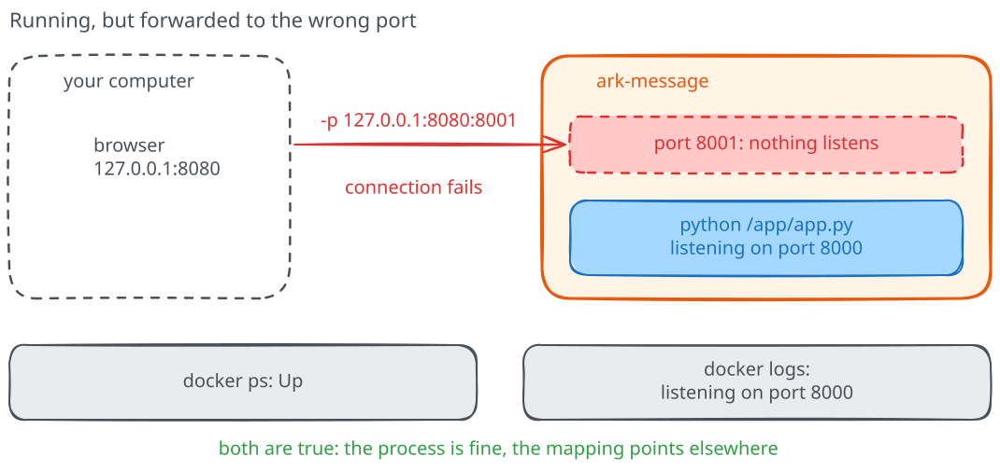
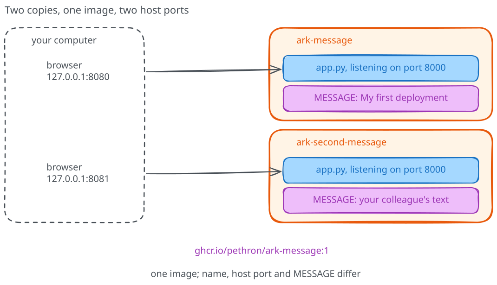

# When a running container doesn't answer

Your service now answers with your own message. Let's change one detail of its
launch command on purpose and watch it stop answering, while Docker keeps
reporting that everything is fine. A small, controlled failure is the cheapest
place to learn which evidence to trust, and afterwards we'll use the same
reasoning to run a second copy for a colleague.

## A controlled mistake

Recreate `ark-message`, but change the container
port in the launch command from `-p 127.0.0.1:8080:8000` to
`-p 127.0.0.1:8080:8001`. Keep every other option unchanged.

Before applying it, predict whether the application will stop, or keep running
but become unreachable through the published port. What would let you tell
those two possibilities apart?

```text
docker stop ark-message
docker rm ark-message
```

Repeat the `docker run` command you used for your message, with the changed
port, then inspect
`docker ps -a --filter name=ark-message` and `docker logs ark-message`.

Try the page again. A request to `http://127.0.0.1:8080/` should now fail, even
though the process can still be running.

If using a terminal, keep the check bounded:

=== "Linux (Bash)"

    ```bash
    curl --fail --show-error --connect-timeout 2 --max-time 5 \
      http://127.0.0.1:8080/
    ```

=== "Windows (PowerShell)"

    ```powershell
    curl.exe --fail --show-error --connect-timeout 2 --max-time 5 `
      http://127.0.0.1:8080/
    ```

This request is supposed to fail. But did the application stop? Look at the
container state and its startup log before opening the hints: they give us two
different pieces of the answer.

<details>
<summary>Hint 1: distinguish the two ports</summary>

The host receives the request on port 8080. Which container port does the new
configuration forward it to, and which port does the startup log say is listening?

</details>

<details>
<summary>Hint 2: restore the connection</summary>

The application still listens on port 8000. Restore the mapping to
`127.0.0.1:8080:8000` when recreating the instance, and check the response again.
You do not need to reinstall Docker or disable the firewall.

</details>

Here is what the broken mapping looked like. Docker kept forwarding
port 8080 faithfully, but to a port where nothing was listening, while the
application waited on 8000 the whole time.



Once it works, explain why "the container is running" was not enough evidence
that a user could reach the service. A running process and a reachable
endpoint are different claims, and keeping them separate makes service
failures easier to diagnose.

!!! success "Checkpoint"

    `ark-message` runs with the mapping `127.0.0.1:8080:8000` again, and
    `http://127.0.0.1:8080/` returns your message. You can say which evidence
    showed the process running and which showed the request going nowhere.

## A second copy for your colleague

A colleague needs their own copy on the same host, with a different message, while
your original service keeps working. Use the same image to create a second
container, then decide which launch options must differ.

This time, try choosing the options yourself. You should be able to visit both
URLs and see different messages; check each container's logs to see where the
requests arrived.

<details>
<summary>Hints if the two copies collide</summary>

Give the second container a different `--name`, such as `ark-second-message`.
Give it a different host port, such as 8081. The application's internal port can
stay at 8000, and the `MESSAGE` values can differ. Use `docker logs` with the
appropriate name to see which instance handled a request.

</details>



Notice that both applications can still listen on port 8000 inside their
containers. Why did we need a different port on the host, then? We'll follow
that connection properly in the networking module.

!!! success "Checkpoint"

    Two containers are running: `http://127.0.0.1:8080/` and
    `http://127.0.0.1:8081/` return different messages, and each container's
    log shows the requests it handled.

## Clean up

Stop and remove the two manually created instances. For the second one, use the
name you actually chose:

```text
docker stop ark-message
docker rm ark-message
docker stop ark-second-message
docker rm ark-second-message
```

If you did not create the second instance, omit its commands. Don't remove a
container just because an example uses its name; inspect it first if in doubt.

The downloaded image remains. This application has no
persistent data volumes, so no global prune or Docker reset is needed. The
same launch settings have now started two copies; each has its own name and
message, while both use the same image and container port.

## What did we just do?

So, to sum up: you ran an application without installing Python, changed its
message without changing the image, and fixed a connection that was pointing to
the wrong port. You also ran a second copy alongside the first one.

Before reading on, answer these without looking back:

- Where did Python and the application code come from, and what did your command add?
- Did a different message require a different image?
- Which observation distinguished a stopped application from a wrong port mapping?
- What remains on your machine after removing the container?
- What would your colleague need to run this example on their own laptop?

If you're working with someone, compare your explanations. If not, try answering
before looking back at the commands: the interesting part is why they worked.

For a less-guided attempt, try the [handover kata](katas/README.md).
Next, the [history of physical servers and VMs](06-from-physical-servers-to-virtual-machines.md)
will put this experience into context. At the end of the module, we'll return to
the two instances and ask what they really isolate.
