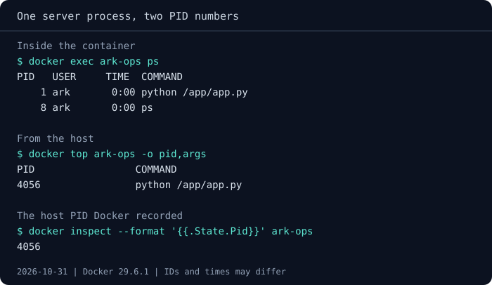
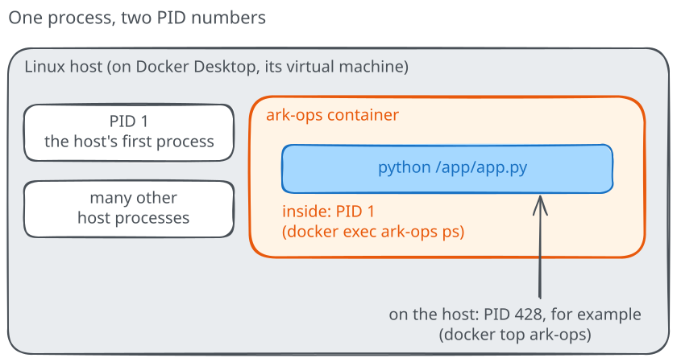

# Processes inside a container

So far you've watched the service from the outside: a page in the browser,
a container in Docker's listing and some application logs. That's enough to
check whether it answers, but it doesn't yet explain what is keeping it alive.
Let's open a shell alongside the server and use it to explore the relationship
between the container, its processes and its files.

## Open a shell alongside the server

From your host terminal, ask Docker to start a shell in `ark-ops`:

```text
docker exec -it ark-ops sh
```

`docker exec` starts an additional process in a running container; here that
process is `sh`, a shell included in our image. The `-i` keeps its input open,
and `-t` gives it a terminal so you can work interactively. People often call
this "logging into the container", but there is no SSH server or remote login
involved: Docker starts the shell directly, without replacing the HTTP server.

The prompt you now see belongs to that shell. The following commands run
**inside the Linux container**, including when you opened it from PowerShell:

```sh
hostname
pwd
ls /app
ps
```

The hostname identifies this instance, while `pwd` shows the shell's current
directory, `/app` for this image. There you'll recognize `app.py`, the
application the image carries with it. Finally,
`ps` lists the processes visible inside the container: look for the Python
server and your `sh`. You'll also see the short-lived `ps` command itself.

Notice the `PID` column, which gives each process a numeric identifier.
The Python command that runs `/app/app.py` has PID 1 here: it is the
**main process**, started by our launch command. Your shell has another PID
because it was added later. Keep that distinction in mind as we try closing
one without closing the other.

First, leave a note that we can find again. Still inside the shell, run:

```sh
echo temporary-instance-state > /tmp/ark-note
cat /tmp/ark-note
```

You should read back `temporary-instance-state`. We chose `/tmp` because any
user may write there, and our shell runs as the same ordinary user as the
server, `ark`, which can't change the files under `/app`. The note now belongs
to this container's writable filesystem, while the image stays as it was.
Before leaving, predict whether ending this shell will stop the page too.
Then run:

```sh
exit
```

You're back at your host prompt. Refresh `http://127.0.0.1:8080/` and check
`docker ps -a`: the service is still running because the process you ended
was the extra shell, not the Python server. Opening and closing a shell is
therefore useful for inspection without restarting the application.

## What makes this process a container

Inside the shell, `ps` listed only the server, your shell and `ps` itself,
and the server had PID 1. Yet the machine that runs your containers has many
other processes, and one of them is surely already number 1 there. So which
number does our server have outside the container? From your host terminal,
put the two views side by side:

```text
docker exec ark-ops ps
docker top ark-ops -o pid,args
```

The first command is the `ps` you ran in the shell: `docker exec` runs it
inside the container, so it prints the container's view, where the line ending
in `python /app/app.py` starts with `1`. `docker top` lists the same
container's processes as the host sees them, and `-o pid,args` asks for just
two columns, the PID and the command line. Look for `python /app/app.py`
again: this time its PID is a larger number, such as `428`. The command line
is how you match the two rows. It's the same program with the same arguments,
because it's the same process, known by one number in the container's list
and another in the host's.

If you run `docker top ark-ops` without `-o`, you get more columns: the PID is
the second one, after the user. The `C` column, whose value changes from one
run to the next, is the share of CPU the process is using, so a server waiting
for requests often shows `0` there.

Docker also records the host PID of each container's main process, so you can
check the match directly:

```text
docker inspect --format '{{.State.Pid}}' ark-ops
```

It prints the number that `docker top` showed beside the server.



Follow `python /app/app.py` from line to line: it's PID 1 in the first list,
and both `docker top` and `docker inspect` report 4056 for it on the host side.
In your terminal the host number will be different, and it changes again
whenever the container restarts, because the server becomes a new process.



Where does that larger number live? On a Linux computer the host is your own
machine, and its process list shows the server with that PID. On Docker
Desktop, the host side is the Linux virtual machine that runs your containers,
so you won't find this process in the Windows or macOS task manager: the
number belongs to the virtual machine's process list, and `docker top` is the
simplest way to read it from your terminal. On Windows the same is true of a
WSL distribution such as Ubuntu: even when Docker Desktop uses WSL 2, your
distribution runs beside Docker's virtual environment, so `ps` there won't
list the server either.

??? note "See the number in the host's full process list"

    `docker top` shows only the container's processes. To find the server among
    all the host's processes, start a throwaway container that shares the
    host's PID namespace instead of getting its own:

    ```text
    docker run --rm --pid=host ghcr.io/pethron/ark-message:1 ps
    ```

    The list is long because it includes the processes of the host itself
    (on Docker Desktop, of its virtual machine). Somewhere in it you'll find
    `python /app/app.py` with the same number that `docker top` printed.
    `--pid=host` removes one of the container's boundaries, which is why we use
    it only for this short look and let `--rm` delete the container right away.

The **kernel** is the core of the operating system: it runs processes,
manages memory and controls access to files, network and devices. Linux can
give a group of processes its own view of some of these resources through
**namespaces**. When Docker starts a container, it creates a set of
namespaces for the main process, and every process added later with
`docker exec` joins the same set. That's why your shell and the server could
see each other and nothing else. The common types each change one view:

- **PID**: a separate process numbering that starts from 1 and shows only
  the container's processes, as `ps` did;
- **mount**: a separate list of mounts, the places where a filesystem or a
  single file is attached to the directory tree, so the container's `/`
  holds the image's files, `app.py` included;
- **network**: separate interfaces, addresses and ports, so two containers
  can both listen on port 8000;
- **UTS**: a separate hostname, which is the short container ID that
  `hostname` printed;
- **IPC**: separate channels that processes use to exchange data directly,
  such as shared memory.

Linux has a few more types. A **user namespace**, for instance, can map
the container's `root`, the all-powerful administrator account, to an
ordinary user on the host. Docker supports it but doesn't enable it by
default, so a container process running as `root` is the host's `root`, held
back by other security settings. Our image avoids the question for the server:
it starts as the ordinary user `ark`. The `USER` column of `ps` inside the
container shows that name, while a plain `docker top` shows its numeric ID,
`1000`, because the host has no user called `ark`.

Namespaces change what the processes can see, while leaving untouched how
much they can use: a process with a private process list can still fill the
machine's memory. That's the job of **control groups**, or **cgroups**.
The kernel places processes in a group, measures the CPU time, memory and
number of processes the group uses and, when configured, enforces limits on
them. Docker creates one cgroup per container and puts all its processes in
it, including shells opened with `docker exec`. We gave `ark-ops` no resource
options, so its cgroup only keeps the accounts: the server can use as much
CPU and memory as the host makes available.

Together, the two features explain what you've seen so far: the server
behaves as if it had a machine of its own, while remaining an ordinary
process of the host's kernel, the one `docker top` lists. If you'd like to
compare namespace identifiers and read cgroup limits yourself, the optional
[namespaces](../advanced/linux-primitives/02-namespaces.md) and
[cgroups](../advanced/linux-primitives/03-cgroups-v2.md) deep dives take
those observations further.

## Which process keeps the container alive?

Let's try the other side of that boundary. In your first host terminal, open
the shell again and leave it waiting at its prompt:

```text
docker exec -it ark-ops sh
```

Now open a **second host terminal**. Before executing the next command,
predict what will happen to the shell in the first terminal: can it keep
running after the server stops?

```text
docker stop ark-ops
```

The stop may take around ten seconds with this application; wait for Docker
to return before continuing. We'll explain that waiting period in the
[stop chapter](04-stopping-a-service.md).

??? note "Why not use kill from inside the shell?"

    The container stops when its main process exits, but sending that process
    a signal doesn't always make it exit. PID 1 has special signal behavior
    on Linux, so for this exercise use `docker stop` from the host. The
    [optional signal experiment](../advanced/linux-primitives/shutdown-service/README.md#why-kill-1-doesnt-always-stop-the-container)
    compares the cases without changing the lifecycle model.

Return to the first terminal. The shell session ends too, although you never
typed `exit` in it; press Enter if necessary to make the returned host prompt
visible. When the main process exits, the container's execution ends and its
remaining processes are terminated. An extra shell doesn't keep the container
alive independently of the server.

From a host prompt, try to open another session before starting the service:

```text
docker exec -it ark-ops sh
```

Docker should report that the container is not running. That error is expected:
`exec` adds a process to a running container, whereas `docker start` starts
the main process of an existing stopped container. Use the latter now, then
open a fresh shell:

```text
docker start ark-ops
docker exec -it ark-ops sh
```

Inside that shell, check the note and the process list:

```sh
cat /tmp/ark-note
ps
exit
```

The note remains even though neither the old server process nor the old shell
survived. Docker kept the stopped container's name, settings and writable
filesystem, then used them to start execution again. **Stopping execution
isn't deleting the container.**

An image supplies the starting files and defaults; the container adds its own
configuration and writable filesystem. Its processes use those files while
they run, but their in-memory work is lost when they end. Finding the note
after a start doesn't mean an unfinished HTTP request also continued where
it left off.

## A process can finish without failing

Our server waits for requests, so it is supposed to keep running. Not every
container has that job, though: imagine using the same image simply to check
which version of Python it contains. Words added after the image name replace
the program the image would normally start, so this time Docker runs
`python --version` instead of the server. Run these commands from a host terminal.
Check that the name `ark-once` is free before using it:

```text
docker run --name ark-once ghcr.io/pethron/ark-message:1 python --version
docker ps -a
docker logs ark-once
```

Python prints its version and finishes, leaving `ark-once` as `Exited (0)`.
Zero conventionally means successful completion; in this case, stopping is
exactly the result we wanted. The same lifetime rule applies to both examples:
the version command finishes quickly, while the HTTP server keeps waiting
for work. Neither needs an open shell session to stay alive.

You can remove the completed job now:

```text
docker rm ark-once
```

You'll often see `--rm` on short jobs to remove them automatically when they
finish. We left it out so you could inspect the result, just as keeping a
failed service around gives you time to read its logs.

Leave `ark-ops` running with its note; the
[replacement experiment](03-restarting-isnt-replacing.md) starts from that state.
