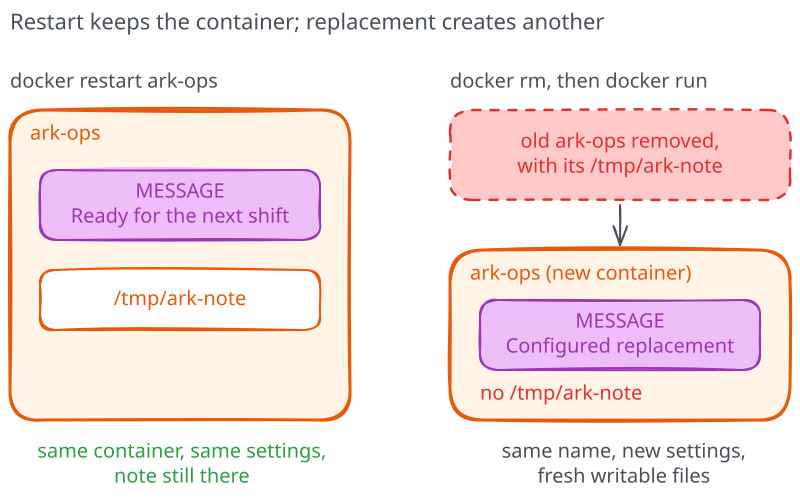
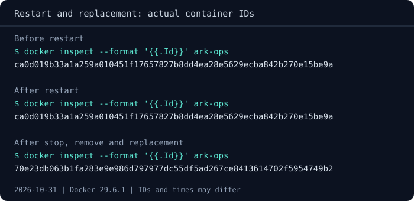

# Restarting vs replacing a container

When the server stopped and started again in the shell experiment, both the
original message and a note written inside the container remained. That's
useful when you want to resume the same service, but now someone wants the
page to say `Configured replacement`. To make that change, we need to supply
a new setting rather than simply start the old process again.

## Replace the configuration

Before replacing anything, let's try the shortcut people often reach for:

```text
docker restart ark-ops
docker exec ark-ops cat /tmp/ark-note
```

The note should still be there, and the browser should still show
`Ready for the next shift`. `docker restart` stops and starts the same
container, using the settings it already has; it doesn't accept a new message.
To supply that setting, stop and remove this instance:

```text
docker stop ark-ops
docker rm ark-ops
```

Now create the replacement with the same launch options, changing only
the message:

=== "Linux (Bash)"

    ```bash
    docker run -d --name ark-ops \
      -e MESSAGE="Configured replacement" \
      -p 127.0.0.1:8080:8000 \
      ghcr.io/pethron/ark-message:1
    ```

=== "Windows (PowerShell)"

    ```powershell
    docker run -d --name ark-ops `
      -e MESSAGE="Configured replacement" `
      -p 127.0.0.1:8080:8000 `
      ghcr.io/pethron/ark-message:1
    ```

Once you've checked the new message
in the browser, predict whether reusing the name also brought back the note:

```text
docker exec ark-ops cat /tmp/ark-note
```

This time `cat` should report `No such file or directory`: the new container
has the old name, but it doesn't inherit the old container's writable files.
The image remains available, which is why the replacement can run, while the temporary note belonged to the removed instance.



**Restart keeps the container; replacement creates another one.** If that
note had been important application data, recreating the service would have
thrown away something we needed. We would need to keep that data outside
the container's lifecycle, which is the problem we'll solve in module 05.



## Leave a change you can repeat

Verify both `/` and `/health`, then keep the replacement's launch command
in your notes. Fixing files by hand inside
a running container might appear quicker, but you've just seen why that change
wouldn't automatically reach its replacement.

The replacement `ark-ops` is running with the message `Configured replacement`.
Leave it running for [the shutdown experiment](04-stopping-a-service.md).
