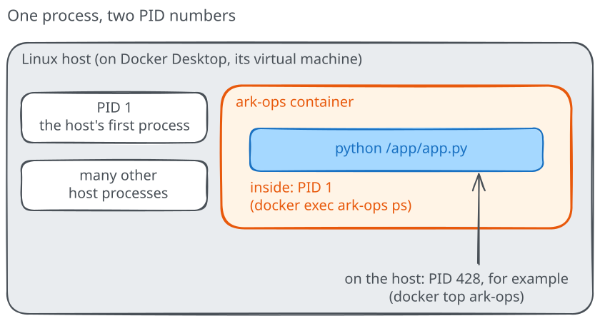

# Namespaces and cgroups

In `ark-ops`, the server was PID 1, yet `docker top` gave that same process
a different number on the engine host. The server also saw its own hostname
and `/app`. How can two instances get their own views while using one kernel?
We'll compare them, then ask a separate question: how much can each use?

## Compare two views

Leave `ark-ops` running and check that `ark-boundary` is free in
`docker ps -a`. Start another copy without a published port:

```text
docker run -d --name ark-boundary --memory=128m --cpus=0.5 ghcr.io/pethron/ark-message:1
```

The two resource options request a 128 MiB memory limit and a CPU-time budget
equivalent to half a CPU for `ark-boundary`. They don't change `ark-ops`.
This example doesn't create load or try to exhaust memory.

Compare what each instance sees:

```text
docker exec ark-ops hostname
docker exec ark-boundary hostname
docker exec ark-ops ps
docker exec ark-boundary ps
docker exec ark-ops uname -r
docker exec ark-boundary uname -r
```

The hostnames differ and each process list has its own Python PID 1. The
kernel releases should match: both processes use the engine host's kernel.
An HTTP request to `http://127.0.0.1:8080/` still reaches `ark-ops`, because
we published its port and didn't publish one for `ark-boundary`.



A **namespace** gives processes a particular view of a resource. Docker
normally gives each of these containers its own PID view and hostname, and
its own mount and network views. A mount view determines which filesystems
appear at paths such as `/app`; a network view has its own interfaces and
port space. Separate mount views can still point at the same underlying data
when we deliberately attach it.

To see that the PID views are different, compare their identifiers:

```text
docker exec ark-ops readlink /proc/self/ns/pid
docker exec ark-boundary readlink /proc/self/ns/pid
```

The values look like `pid:[4026532406]` and should differ. They identify
namespace membership on this kernel, not a container address or a number to
reuse later. A process added with `docker exec` joins the existing container's
view, which is why your shell could see its server.

## Read a resource boundary

A separate process view doesn't set a memory or CPU budget. Linux uses
**control groups**, or **cgroups**, to account for and, when configured,
limit resources used by groups of processes. Docker translates the options
we supplied for `ark-boundary` into settings the engine host can enforce.

First compare Docker's requested settings:

```text
docker inspect --format 'memory={{.HostConfig.Memory}} nano_cpus={{.HostConfig.NanoCpus}}' ark-boundary
docker inspect --format 'memory={{.HostConfig.Memory}} nano_cpus={{.HostConfig.NanoCpus}}' ark-ops
docker info --format '{{.CgroupVersion}}'
```

For `ark-boundary`, expect `134217728` bytes and `500000000` nano-CPUs;
the latter represents 0.5 CPU. `ark-ops` was created without either
container-specific setting, so those requested values are normally zero.
An outer limit, such as Docker Desktop's VM budget, can still constrain both.

If the engine reports cgroups version **2**, look at the controls visible
inside the limited container:

```text
docker exec ark-boundary sh -c 'cat /sys/fs/cgroup/memory.max; cat /sys/fs/cgroup/cpu.max'
```

The first line should be `134217728`. The second contains a CPU quota and
period, commonly `50000 100000`: half of each period's CPU time. The period
can differ, so compare the ratio rather than memorizing those numbers.
This is a ceiling, not a reservation or a promise to run on a particular
core. Memory and swap have separate controls.

An engine using cgroups version **1** exposes different controller paths, so
the v2 file command doesn't apply. The `docker inspect` values show what was
requested; they alone don't prove the host enforced it. If Docker reports that
a control is unsupported, or the expected v2 files cannot be read, keep that
result and investigate your engine's configuration rather than claiming the
limit worked. Rootless engines, for example, depend on resource delegation.

## Return to the service

Would giving `ark-ops` a separate PID view prevent it from using too much
memory? The process view and the resource budget answer different questions.
To give `ark-ops` a new budget, you'd create a replacement with the intended
settings, just as changing its message required a replacement.

You've finished the walkthrough. Stop and remove only the two containers
created here; the image stays available:

```text
docker stop ark-boundary ark-ops
docker rm ark-boundary ark-ops
```

The [service-change kata](katas/README.md) gives you a different change to
plan and verify. For more detail, the optional
[namespace](../advanced/linux-primitives/02-namespaces.md) and
[cgroup](../advanced/linux-primitives/03-cgroups-v2.md) discussions explore
the boundaries further.
