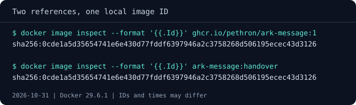

# Image names, tags and IDs

We found the course image and recorded its ID, so let's give it a name we can
use for our handover. Docker allows several references to point to the same
image, which comes in handy when you want to organize local work or prepare an
image for a particular destination.

## Read the reference we've been using

First, take a look at the reference we've used all along:
`ghcr.io/pethron/ark-message:1`. Reading from the left, `ghcr.io` is the address
of the registry that stores the image, GitHub's container registry, and
`pethron/ark-message` is the **repository**, a namespace that belongs to an
account followed by the image's name. After the colon, `1` is the **tag**,
chosen by the publisher; for the course we use it to mean the first version of
the service. Other publishers might choose dates, full release numbers or names
such as `stable`, so reading a project's tag documentation is part of choosing
an image.

## Give the image a local handover name

For our exercise, we'll call the image `ark-message:handover`: a short name
with no registry address, and a tag that describes what we're preparing.
Check `docker image ls ark-message` first. If that tag already belongs to
another task, choose a different one throughout the module so that your
existing work stays untouched.

```text
docker tag ghcr.io/pethron/ark-message:1 ark-message:handover
docker image ls ark-message
docker image inspect --format '{{.Id}}' ark-message:handover
```

Compare the ID with the one you recorded for the course image. Both names
should lead to the same value because `docker tag` adds a reference to
content Docker already has. The layers remain shared, so the extra name
costs very little space even though the image now appears under two
references.



That also gives us a convenient way to test our archive later: we can
remove the handover tag and restore it while keeping
`ghcr.io/pethron/ark-message:1` available for the other exercises. Removing
that extra reference leaves the original name and the content it points to in
place.

## What should the tag tell us?

Our tag describes a task, which is enough while we're passing this image
through a local exercise. A team releasing software has more to communicate:
which release is available, what an update might change and whether a tag
will stay attached to the same content. Those decisions belong to the
publisher's release policy.

For example, Docker uses `latest` as the tag when you leave one out of a
reference. Its content is whatever the publisher assigned to that name,
so check the project's policy before choosing it for a service. A full
release tag such as `1.4.2` may be a more useful choice for tracking a
release, although keeping it fixed still depends on the publisher's policy
and any immutability controls in the registry. Our own `1` sits in between:
it promises the first version of the service, and we may still move it to a
corrected build of that version.

If this is your first encounter with software versioning, the optional
[versioning and tagging discussion](../advanced/images-and-distribution/versioning-and-tagging-strategies.md)
builds on this example to explain SemVer, calendar versions and build
identifiers. You can come back to it when you start choosing a convention
for your own images.

For now, keep `ark-message:handover` available and let's look at
[what the image contains](03-what-an-image-contains.md). That will help us
decide which parts of the service will travel in the archive and which
parts our colleague will need alongside it. This chapter leaves no container
running; if you stop here, `docker image rm ark-message:handover` removes
only the extra tag and leaves the course image in place.
