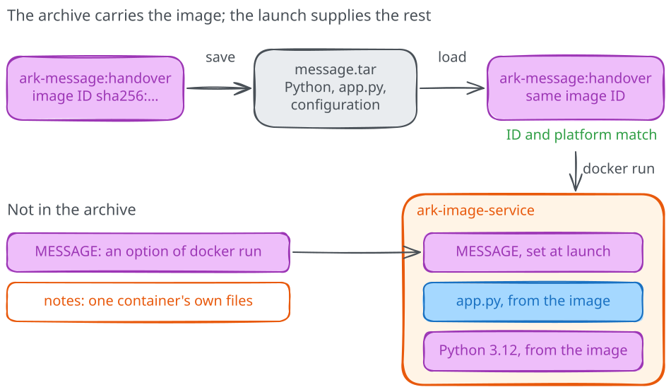

# Saving and loading image archives

We have a name for our handover, and our colleague needs a file they can
receive. Docker can save the image's layers, configuration and tag in an
archive, then load that archive back into an engine. We'll do both steps on
your computer so that we can check the procedure before asking someone else
to follow it.

## Save the named image

The `ark-message:handover` tag from the previous chapter is still available.
Open a terminal in a directory where you can create files, such as your home
directory, and work from there for the rest of the module. We'll keep the
archive in its own directory so it's easy to find and remove after the
exercise. Create it with the command for your shell;
if the directory already exists, stop and inspect its contents before
continuing to avoid overwriting an earlier archive or someone else's files.
The archive uses additional disk space alongside Docker's stored image, so
make sure you have room for both before saving.

=== "Linux (Bash)"

    ```bash
    mkdir ark-image-handover
    ```

=== "Windows (PowerShell)"

    ```powershell
    New-Item -ItemType Directory -Path .\ark-image-handover
    ```

Once the directory is ready, ask Docker to save our tagged image into
`message.tar`:

```text
docker image save --output ark-image-handover/message.tar ark-message:handover
```

The resulting `message.tar` contains what Docker needs to restore this
image, including its configuration, layers and handover tag, so Python and
`app.py` travel together. We can also predict what stays outside the archive:
the message and port belong to the launch command,
the note belongs to a container's writable filesystem, and running processes
belong to that container's execution.



Mind that Docker also has an `export` command for exporting a container's
filesystem. Use `image save` here, because our next step needs an image
archive with the metadata required by `image load`.

## A standard format inside the archive

Docker includes a manifest in the archive to connect the tag with the image's
configuration and layer files. We'll open it after the restore and follow
those pieces in [Image layers](03-what-an-image-contains.md). First, let's
check that the handover can restore the reference and start the service.

## Restore the name from the archive

To check the restoration, we need something to compare with the result.
Record the image's full ID and platform before removing its handover tag:

```text
docker image inspect --format '{{.Id}}' ark-message:handover
docker image inspect --format '{{.Os}}/{{.Architecture}}' ark-message:handover
```

We can now remove **only our extra tag**. Because
`ghcr.io/pethron/ark-message:1` still points to the same image, Docker keeps
that reference and its content available for the other exercises:

```text
docker image rm ark-message:handover
docker image ls ark-message
```

Check that the `handover` row has disappeared, then load the archive.
Repeating the inspection commands will let us see whether the restored
reference leads back to the image we saved:

```text
docker image load --input ark-image-handover/message.tar
docker image inspect --format '{{.Id}}' ark-message:handover
docker image inspect --format '{{.Os}}/{{.Architecture}}' ark-message:handover
```

Compare both values with your notes before continuing; the ID and platform
should match. That gives us evidence that our archive restores the reference
and image identity on this engine. When you write your handover, include
that test condition: Docker could reuse layers still in its cache, so
trying the archive on another computer remains a separate check. Leave
the cache in place, since clearing shared images would disrupt other work.

## Use the restored image for our service

Now let's use the restored reference to run the application again.
Check that `ark-image-service` and loopback port 8080 are still free. We've
added `--pull never` so that the service must use the locally available image,
as it would on a machine that can't reach a registry:

```text
docker run -d --name ark-image-service --pull never -e MESSAGE="Loaded from our archive" -p 127.0.0.1:8080:8000 ark-message:handover
```

Open `http://127.0.0.1:8080/` and `/health` on that address to check the
message and health response. You should see `Loaded from our archive` and
`{"status": "ok"}`; if the application needs a moment to start, retry,
then read `docker logs ark-image-service` if it keeps failing. Once it
responds, check which image Docker used for this container:

```text
docker inspect --format '{{.Image}}' ark-image-service
```

The returned ID should match the one in your notes, connecting the running
service to the image we saved and restored. The archive supplied Python, our
application and its default command, so the launch only had to add the message
and the port. Keep the archive and tag while you finish the handover notes.
Stop and remove only this test service:

```text
docker stop ark-image-service
docker rm ark-image-service
```

The tag and `ark-image-handover/message.tar` remain available. Now that the
restored service works, let's look at
[the layers and configuration](03-what-an-image-contains.md) that made
the handover possible.
