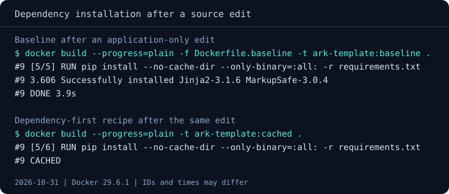
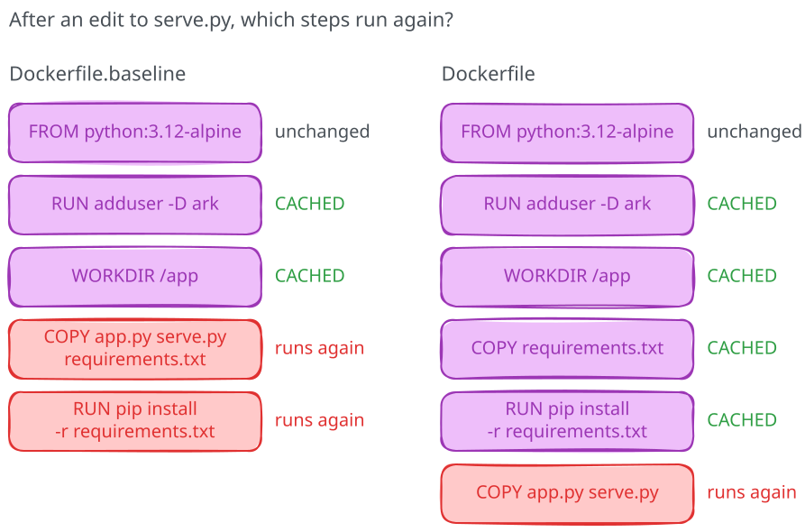

# Dependencies and layer caching

The original service uses Python's standard library, so its recipe has no
packages to install. Many applications need a library, though, and Docker
reuses a build step only while that step's inputs, including the result of
the steps before it, stay the same. Let's add one small dependency to the
service and check what an ordinary source edit does to its installation.

The supplied `template-service` keeps the original `app.py` unchanged.
A small launcher uses Jinja2, a Python template library, to turn
`Hello {{ audience }}` into a message chosen through `AUDIENCE`. It then
starts our familiar service; `MESSAGE` still overrides the generated default.
The HTTP response and `/health` contract stay the same.

## Look at the new input

The previous chapter leaves the terminal in your own `my-message-service`
directory. Move into the supplied `template-service`, where this exercise
adds a dependency; its builds need network access to fetch Alpine and Python
packages:

=== "Linux (Bash)"

    ```bash
    cd ../template-service
    ```

=== "Windows (PowerShell)"

    ```powershell
    Set-Location ..\template-service
    ```

Open `requirements.txt`. It pins Jinja2, a pure-Python library. pip also
installs its runtime dependency, MarkupSafe, from a prebuilt wheel. The
recipe asks pip to use wheels, so this service needs no compiler.

The `Dockerfile.baseline` copies both the dependency list and application
before installation. Check `docker image ls ark-template` first; if the
`baseline` or `cached` tag belongs to another task, choose unused tags and
use them throughout the chapter. Build that version and the supplied recipe,
recording their output:

=== "Linux (Bash)"

    ```bash
    docker build --progress=plain -f Dockerfile.baseline -t ark-template:baseline .
    docker build --progress=plain -t ark-template:cached .
    ```

=== "Windows (PowerShell)"

    ```powershell
    docker build --progress=plain -f Dockerfile.baseline -t ark-template:baseline .
    if ($LASTEXITCODE -ne 0) { throw "Baseline build failed" }
    docker build --progress=plain -t ark-template:cached .
    if ($LASTEXITCODE -ne 0) { throw "Cached build failed" }
    ```

## Put each input where it belongs

Read `Dockerfile`. It copies `requirements.txt` and installs the packages
before copying the application:

```dockerfile
COPY --chmod=644 requirements.txt ./
RUN pip install --no-cache-dir --only-binary=:all: -r requirements.txt
COPY --chmod=644 app.py serve.py ./
```

The dependency list changes less often than the application, so the build
can reuse the installation result while that list stays the same. In the
baseline, `serve.py` is already part of the image state before pip runs.
An edit to that file therefore changes the input to the installation step,
and Docker has to run it again.

Now make an application-only change, the kind that happens far more often
than a new dependency. Append a comment such as `# rebuild observation` to
`serve.py`, leaving its behavior unchanged, then repeat the two builds above.
In the baseline log, `pip install` runs again. In the supplied recipe, it says
`CACHED`; the changed source is copied afterward. If you've done this
experiment before with the same comment, the builder may still hold a result
for that exact `serve.py` and report `CACHED` in both logs, so pick a comment
it hasn't seen. The log shows which work repeated, while the elapsed time tells
you how that difference felt on your machine. Time both rebuilds with the
timer for your shell:

=== "Linux (Bash)"

    ```bash
    time docker build --progress=plain -f Dockerfile.baseline -t ark-template:baseline .
    time docker build --progress=plain -t ark-template:cached .
    ```

=== "Windows (PowerShell)"

    ```powershell
    Measure-Command { docker build --progress=plain -f Dockerfile.baseline -t ark-template:baseline . | Out-Host }
    Measure-Command { docker build --progress=plain -t ark-template:cached . | Out-Host }
    ```

The elapsed times depend on the builder's cache and other activity on your
machine, so treat them as observations rather than a universal speed claim.
Which operations rerun is the evidence to compare.





Restore `serve.py` by removing your comment. A change to `requirements.txt`
should invalidate the installation step in either recipe, because pip must
then resolve the new input.

## Check the service

Check that `ark-template` and port 8080 are free, then launch the supplied
recipe:

```text
docker run -d --name ark-template -e AUDIENCE="the release team" -p 127.0.0.1:8080:8000 ark-template:cached
```

Open `http://127.0.0.1:8080/`. Expect `Hello the release team` in the message
and a successful `/health`. If the page doesn't load, wait a moment and retry,
then check `docker ps -a` and `docker logs ark-template`. Check that the image
contains and can run the dependency:

```text
docker exec ark-template whoami
docker exec ark-template python -c "from jinja2 import Template; print(Template('Hello {{ audience }}').render(audience='the release team'))"
docker inspect --format '{{json .Mounts}}' ark-template
```

Expect `ark`, `Hello the release team`, and an empty mount list. The service
still comes from the image alone; no application source directory is needed
at runtime.

## Clean up

Stop and remove the test container, then the two image tags:

```text
docker stop ark-template
docker rm ark-template
docker image rm ark-template:baseline ark-template:cached
```

Keep the supplied files for the kata. These commands leave shared base images
and the build cache alone, and the chapter leaves nothing running. You now
have a dependency and a build whose log shows why the application copy belongs
after installation. Next, let's follow the image's
[start command and stop signals](04-commands-and-signals.md).
