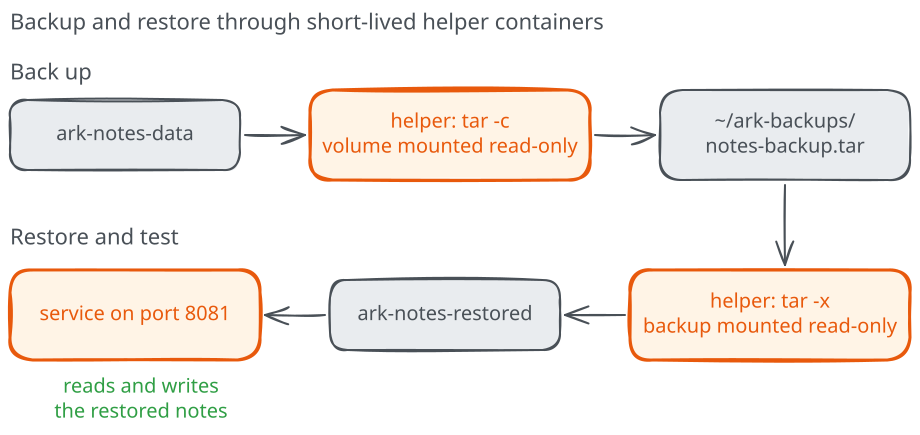

# Backing up and restoring a volume

The notes now survive every replacement, which covers the changes you make
on purpose. They won't survive a `docker volume rm` typed in the wrong
terminal, a broken disk, or a move to a new machine, because in all of those
cases the volume itself is gone. For that you need a **backup**: a copy of the
data kept somewhere else, together with a restore you've actually tried.
A backup you've never restored is only a hope.

In this chapter we'll copy the notes out of `ark-notes-data` into an archive
on your computer, restore that archive into a brand-new volume, and prove
the restore through the service itself.

## Start with the notes you kept

The previous chapters left two notes in `ark-notes-data`, with no service
container running. Start the supplied image with that same volume, then add
one more note so the restore can check all three:

=== "Linux (Bash)"

    ```bash
    docker run -d --name ark-notes -p 127.0.0.1:8080:8000 \
      --mount type=volume,source=ark-notes-data,target=/data ark-notes:v1
    curl -d "Call the plumber" http://127.0.0.1:8080/notes
    ```

=== "Windows (PowerShell)"

    ```powershell
    docker run -d --name ark-notes -p 127.0.0.1:8080:8000 `
      --mount type=volume,source=ark-notes-data,target=/data ark-notes:v1
    curl.exe -d "Call the plumber" http://127.0.0.1:8080/notes
    ```

If curl can't connect, the service is still starting: wait a second and
retry. The answer should report `"notes": 3`. The service runs as
`ark`, an ordinary account that the image's `Dockerfile` creates and that
owns `/data`. When Docker mounted the new, empty volume there, it copied the
image's `/data` into it, owner included, which is why `ark` can write notes
in the volume.

## The plan

A volume can be mounted into any container, not only the one that runs the
service. That gives us a simple way in: start a short-lived helper container
with the volume at one path and a folder from your computer at another, and
let it copy files from one to the other with `tar`, a standard tool for packing
files into a single archive and unpacking them again. For the helper, we'll use
`python:3.12-alpine`, the base of our notes image, which is already on your
engine after the build and includes `tar`.
Its default user is root, so it can read the notes regardless of which account
owns them and recreate those owners when restoring.



We'll stop the service before copying. While the service runs, a note could
arrive halfway through the copy, and stopping it guarantees the archive matches
one moment in the service's life. Our notes file is simple enough that a
stopped service is all we need. A database would need more care: use its own
documented backup procedure instead of copying the files it's using.

## Prepare a backup folder

Keep backups outside the course checkout, so they don't mix with the example
files. Create a folder in your home directory and move into it:

=== "Linux (Bash)"

    ```bash
    mkdir -p ~/ark-backups
    cd ~/ark-backups
    ```

=== "Windows (PowerShell)"

    ```powershell
    New-Item -ItemType Directory -Force "$HOME\ark-backups" | Out-Null
    Set-Location "$HOME\ark-backups"
    ```

Run the rest of this chapter from that folder. Before going on, open
`http://127.0.0.1:8080/notes` and write down the notes you see: they're what
a successful restore must give back.

## Make the backup

Stop the service, run the helper, then start the service again:

=== "Linux (Bash)"

    ```bash
    docker stop ark-notes
    docker run --rm \
      --mount type=volume,source=ark-notes-data,target=/data,readonly \
      --mount "type=bind,source=$(pwd),target=/backup" \
      python:3.12-alpine tar -C /data -cf /backup/notes-backup.tar .
    docker start ark-notes
    ```

=== "Windows (PowerShell)"

    ```powershell
    docker stop ark-notes
    docker run --rm `
      --mount type=volume,source=ark-notes-data,target=/data,readonly `
      --mount "type=bind,source=$($PWD.Path),target=/backup" `
      python:3.12-alpine tar -C /data -cf /backup/notes-backup.tar .
    docker start ark-notes
    ```

The helper mounts the volume at `/data` with `readonly`, so the backup can read
the notes but can't change them by mistake. The bind mount makes your backup
folder appear as `/backup`. The command after the image name runs `tar`:
`-C /data` moves into the volume first, `-c` creates an archive, `-f` names the
archive file, and the final `.` packs everything in the current directory,
which is the volume. `--rm` removes the helper as soon as `tar` finishes,
since it has nothing else to do.

The service was stopped only for the time `tar` needed, a second or so for
our notes. For a real service, plan that pause as a short maintenance window.

You should now have `notes-backup.tar` in your backup folder. Let's look
inside it, again with a helper, this time mounting the folder read-only:

=== "Linux (Bash)"

    ```bash
    docker run --rm \
      --mount "type=bind,source=$(pwd),target=/backup,readonly" \
      python:3.12-alpine tar -tvf /backup/notes-backup.tar
    ```

=== "Windows (PowerShell)"

    ```powershell
    docker run --rm `
      --mount "type=bind,source=$($PWD.Path),target=/backup,readonly" `
      python:3.12-alpine tar -tvf /backup/notes-backup.tar
    ```

`-t` lists the contents and `-v` adds details. You'll see two entries,
`./` for the volume's top directory and `./notes.txt`, both with `1000/1000`
as their owner. Those are the numeric user and group IDs of `ark` in our
image: the archive records owners as numbers, because names exist only
inside an image's account list. Keeping them matters, as we'll see in a moment.

On Linux Engine, the archive itself belongs to root on your computer, because
the helper ran as root. You can still delete it from your own folder with
`rm -f notes-backup.tar` when you no longer need it.

## Restore into a new volume

A restore you test by overwriting your only copy of the data is a gamble,
so we'll restore into a new volume and leave `ark-notes-data` untouched.
Create it and unpack the archive into it:

=== "Linux (Bash)"

    ```bash
    docker volume create ark-notes-restored
    docker run --rm \
      --mount type=volume,source=ark-notes-restored,target=/data \
      --mount "type=bind,source=$(pwd),target=/backup,readonly" \
      python:3.12-alpine tar -C /data -xf /backup/notes-backup.tar
    ```

=== "Windows (PowerShell)"

    ```powershell
    docker volume create ark-notes-restored
    docker run --rm `
      --mount type=volume,source=ark-notes-restored,target=/data `
      --mount "type=bind,source=$($PWD.Path),target=/backup,readonly" `
      python:3.12-alpine tar -C /data -xf /backup/notes-backup.tar
    ```

This time the volume is writable and the backup folder is read-only, the
reverse of the backup, and `-x` extracts. Running as root, `tar` gives every
file the owner recorded in the archive, so `ark` owns the notes again inside
the new volume.

Now the real test. Start a second service with the restored volume. Check
`docker ps -a` for a container already named `ark-notes-restored`; if Docker
reports port 8081 is in use, change the host-side port in `-p` and use it in
the URL:

```text
docker run -d --name ark-notes-restored -p 127.0.0.1:8081:8000 --mount type=volume,source=ark-notes-restored,target=/data ark-notes:v1
```

Open `http://127.0.0.1:8081/notes` and compare the list with the one you wrote
down. Reading the notes through the service checks more than the presence of
a file: the right data reached the right path, with owners and permissions
the service accepts. Add one more note to the restored service:

=== "Linux (Bash)"

    ```bash
    curl -d "Written after the restore" http://127.0.0.1:8081/notes
    ```

=== "Windows (PowerShell)"

    ```powershell
    curl.exe -d "Written after the restore" http://127.0.0.1:8081/notes
    ```

The answer reports the new total, which proves that `ark` can write to the
restored data and not only read it. Then reload `http://127.0.0.1:8080/notes`:
the original service doesn't have the new note. The two volumes are independent
copies, so you can test a restore without risking the data in use.

<details>
<summary>The restored service exits or can't save notes</summary>

Look at `docker logs ark-notes-restored`. `Permission denied` means the
restored files don't belong to `ark`: check with
`docker run --rm --mount type=volume,source=ark-notes-restored,target=/data ark-notes:v1 ls -ln /data`,
which shows numeric owners. If they're `0`, the notes already belonged to
root when you made the backup; the kata at the end of this module deals with
that situation.
An empty list usually means the archive was created from the wrong volume or
an empty folder: list its contents again with `tar -tvf`.

</details>

## What this backup proves

You've shown that the archive in your backup folder can rebuild the notes
into a fresh volume on this engine, and that the service accepts the result.
The same restore commands should work with this archive on another machine
running Docker, but only an actual restore there would prove it.

A complete backup routine needs a few decisions this chapter leaves open:
how often to run it, how many archives to keep, and where to store them,
ideally on a different machine from the one running the service. The course
returns to these questions when it covers recovering a service from an
incident.
For now, when to use this approach: **any time you're about to do something
risky to a volume**, such as moving it, renaming it or upgrading the
service in a way that changes its data.

## Reset

Remove the restore test, keeping the original service and its volume:

```text
docker stop ark-notes-restored
docker rm ark-notes-restored
docker volume rm ark-notes-restored
```

When you've finished with the module, remove the service, its data and the
image too, after checking that you no longer need the notes:

```text
docker stop ark-notes
docker rm ark-notes
docker volume rm ark-notes-data
docker image rm ark-notes:v1
```

Keep or delete `notes-backup.tar` in your backup folder as you prefer.
Before starting the kata, try explaining from memory why the restore needed
root to run `tar`, while the service itself never did.
