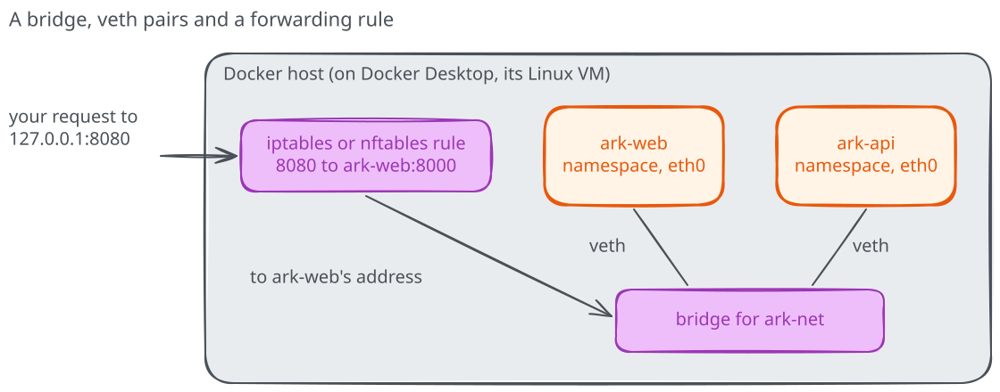

# Bridges and published ports

The frontend can reach `ark-api:8000` on `ark-net`, while your browser reaches
the frontend through `127.0.0.1:8080`. Those are two different paths. Let's
look at the network that connects the containers and the extra step needed
to reach the frontend from outside it.

## Look at the container's connection

The recovered stack is still running. Ask the frontend which interfaces it
can see, then ask Docker how it created the network:

```text
docker exec ark-web ip addr
docker network inspect --format '{{.Driver}} {{json .IPAM.Config}}' ark-net
```

In the first output, find `lo`, the container's loopback interface, and
`eth0`, which has an address on `ark-net`. The network inspection should
report the `bridge` driver and the subnet Docker selected. The exact address
and interface identifiers depend on your engine.

Each container has a **network namespace**, its own view of interfaces,
addresses and ports. The `eth0@if...` notation is a clue to a **veth pair**:
a virtual connection with one end in the container's namespace and the other
attached to a Linux bridge on the engine host. That bridge acts like a
software switch connecting the containers on this network. The interface
listing shows the container end; it doesn't show the full host-side bridge.

On native Linux the bridge belongs to the machine running the engine. With
Docker Desktop it belongs to Desktop's managed Linux environment, not to the
Windows or macOS network-interface list. We can use Docker's inspection from
either setup without changing those host interfaces.



## Follow the published port

Compare the two services:

```text
docker port ark-web
docker port ark-api
```

The frontend maps host loopback port `8080`, or the alternative you selected,
to its container port `8000`. The API has no published mapping, yet the
frontend reaches `ark-api:8000` across the bridge. Docker arranges forwarding
for the published port; the mechanism can involve packet-filtering rules,
address translation or a
proxy, depending on the engine and platform. Docker Desktop also forwards
the connection from your computer into its managed Linux environment.

Publishing to `127.0.0.1` limits the intended entry point to loopback on a
local, current engine. With a remote engine, that loopback belongs to the
remote host. Engines older than Docker 28 have an additional same-network
exposure caveat for localhost publishing; use a current engine and consult
the [port publishing documentation](https://docs.docker.com/engine/network/port-publishing/).
Leaving the API unpublished removes a host-port mapping, not access from
its network peers or necessarily from the engine host.

## Why the first lookup failed

The first attempt put both containers on Docker's default `bridge`, which
doesn't provide automatic container-name resolution. The user-defined
`ark-net` provides Docker's embedded name service for its members. Network
addresses can change when a container is replaced, so keeping the name in
`BACKEND_URL` is more useful than recording an address.

Docker has other network choices for different jobs: `none` gives a container
only a loopback interface; host networking shares the host's network space
where supported; overlay networks connect services across hosts; and
macvlan or ipvlan can attach containers to a physical network. They have
different prerequisites and trade-offs. A user-defined bridge is enough for
this single-engine task.

Before cleaning up, explain which two paths a request follows from your
browser to the API and which port each hop uses. Then remove only this stack:

```text
docker rm -f ark-web ark-api
docker network rm ark-net
```

The image remains available for the [networking kata](katas/README.md),
which starts its own stack.
