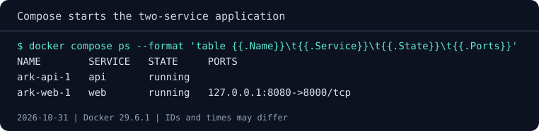

# Defining a stack with Compose

Our application has two parts: a small API that answers on `/health`, and a
web frontend that calls it and wraps the API's answer in its own response.
The frontend finds the API through the address in its `BACKEND_URL`
environment variable, so running the pair by hand takes some care. You build
an image, create a network, then start two containers with the right names,
network, variable and published port. Now picture sending those steps to a
colleague. One typo in a container name and they're reading
`name_resolution` errors instead of your page.

**Docker Compose** lets you write the whole setup down once, in a file, and
start it with one command. In this chapter we'll translate those manual
commands into that file and run the same two services from it.

## Start from the supplied stack

Use the supplied stack in a course checkout. You need Docker running Linux
containers, as set up in module 01, and either a browser or curl. On Windows,
call curl as `curl.exe`. Docker Desktop includes Compose; on Linux Engine,
install the Compose plugin if `docker compose version` doesn't answer, and
prefix the commands with `sudo` if your setup requires it.

The chapter creates the Compose project `ark`: containers `ark-api-1` and
`ark-web-1` and the network `ark_default`. It publishes local port `8080`.
Check `docker ps -a` for containers already using those names. If port 8080
is unavailable, Compose reports a bind error when it starts the frontend;
change the host-side port in `compose.yaml` and update the URL.

From the [root of your course checkout](../before-you-start.md#get-the-course-files), move into the supplied directory:

=== "Linux (Bash)"

    ```bash
    cd 07-compose/stack
    ```

=== "Windows (PowerShell)"

    ```powershell
    Set-Location .\07-compose\stack
    ```

The `network-service` directory inside it holds the two programs, `api.py`
and `web.py`, and a `Dockerfile` that copies both into one image. The
image's default command starts the API; the frontend runs from the same
image with a different command.

## From commands to a file

Here's how you would start the stack by hand from `network-service`, with
plain `docker` commands. There's no need to run them, but read them once:

```text
docker build -t ark-network:v1 .
docker network create ark-net
docker run -d --name ark-api --network ark-net ark-network:v1
docker run -d --name ark-web --network ark-net -p 127.0.0.1:8080:8000 \
  -e BACKEND_URL=http://ark-api:8000/health \
  ark-network:v1 python /app/web.py
```

The API gets no published port, so only containers on `ark-net` can reach
it. The frontend joins the same network, finds the API by its container
name through `BACKEND_URL`, and is published on your computer's loopback
address.

Open `compose.yaml` in this directory. It describes the same stack:

```yaml
name: ark

services:
  api:
    build: ./network-service

  web:
    build: ./network-service
    command: ["python", "/app/web.py"]
    environment:
      BACKEND_URL: http://api:8000/health
    ports:
      - "127.0.0.1:8080:8000"
```

The file is written in YAML, where indentation shows what belongs to what.
`name` gives the whole application a project name, `ark`. Under `services`
each entry is one service, a part of the application that runs as a
container. Every option you passed to `docker run` has a place here:

- `build` points to the directory with the Dockerfile, `network-service`,
  relative to the Compose file, so Compose builds the image for you.
- `command` replaces the image's default command, just like the words after
  the image name in `docker run`.
- `environment` sets `BACKEND_URL`, as `-e` did.
- `ports` publishes the frontend on `127.0.0.1:8080`, as `-p` did.

Two things are missing, and that's on purpose. There's no network: Compose
creates one for the project and attaches every service to it. And the
frontend calls `http://api:8000`, using the service name `api`, because on
that network each service can be reached by its name. The API still has no
`ports`, so it stays private to the stack.

## Start it

Start the whole stack in the background:

```text
docker compose up -d
```

The first run builds the image for each service, then creates the network
and the two containers. The last lines look like this:

```text
 Network ark_default Created
 Container ark-web-1 Created
 Container ark-api-1 Created
 Container ark-web-1 Starting
 Container ark-api-1 Starting
 Container ark-api-1 Started
 Container ark-web-1 Started
```

Ask the frontend for a page:

=== "Linux (Bash)"

    ```bash
    curl http://127.0.0.1:8080/
    ```

=== "Windows (PowerShell)"

    ```powershell
    curl.exe http://127.0.0.1:8080/
    ```

If curl can't connect, the frontend is still starting: wait a second and
retry. The frontend answers with its own name and, nested inside, the API's
reply:

```json
{"service": "ark-web", "backend": {"service": "ark-api", "status": "ok"}}
```

## Look at the stack

Compose has its own versions of the commands you already use, scoped to the
project in the current directory. List its containers:

```text
docker compose ps
```

You'll see `ark-api-1` and `ark-web-1`, with the published port next to the
frontend only.



Read the frontend's logs next:

```text
docker compose logs web
```

Notice that you name the service, `web`, rather than the container. Each log
line starts with `web-1 |`, followed by the request you just made.

That's the handover: with the file and the course checkout, your colleague
runs one command instead of five. **The file becomes the documentation of how
the application runs**, and every `up` starts from it. The chapter leaves
the stack running. The next chapter looks at what Compose did for you behind
that command.
