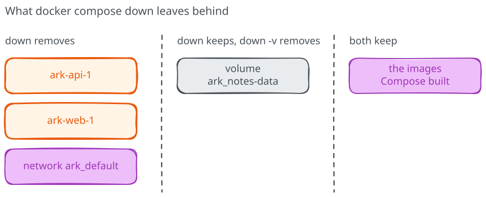

# Projects, networks and volumes in Compose

The previous chapter left two containers running on their own network after
`docker compose up` created them. Compose also gives us a `down` command to
remove the project's containers and network when we're done. Under both
commands are the same Docker operations you could type by hand; what Compose
adds is a memory of which objects belong to this application. Let's look at
those objects and at how Compose decides what to do when you run `up` again.

## Everything belongs to a project

Every Compose application is a **project**, and the `name: ark` line in the
file sets its name. Compose builds the names of everything it creates from
it. Look at the networks:

```text
docker network ls
```

Next to Docker's own `bridge`, `host` and `none`, you'll find `ark_default`:
the network Compose created for the project. It plays the role of the
`ark-net` network you would create by hand with `docker network create`.
The containers are named after the project and the service,
`ark-api-1` and `ark-web-1`, where the number tells apart containers of the
same service. Compose also labels each object with the project it belongs to.
That's how `docker compose ps` and `docker compose down` find exactly your
containers, without touching anything else running on the machine.

## Services find each other by name

The frontend calls `api`, the name of the service in the file. Ask
the frontend what that name means:

```text
docker compose exec web python -c "import socket; print(socket.gethostbyname('api'))"
```

`docker compose exec` works like `docker exec`, but takes the service name.
It prints the API's address on `ark_default`, for example `172.18.0.2`.
Compose registers each service name with Docker's name server on the project
network, so the configuration can say `api` and keep working whatever the
container is called or whatever address it gets. On a network you create
yourself, Docker resolves container names the same way; Compose adds the
service names and chooses the container names for you.

## `up` compares, then acts

Run the same command again:

```text
docker compose up -d
```

This time nothing is built or created. Compose reports both containers as
`Running` and leaves them alone, because they already match the file.
**`up` describes the state you want:** Compose compares what the file asks
for with what's running, and only changes the difference.

Let's give it a difference. Open `compose.yaml` and change the frontend's
port from `127.0.0.1:8080:8000` to `127.0.0.1:8081:8000`. If Docker reports
that port 8081 is in use, choose another loopback host port in `compose.yaml`
and use it in the URL too; keep the container port at 8000. Before saving, predict which
containers Compose will touch, then run `docker compose up -d` once more.

```text
 Container ark-api-1 Running
 Container ark-web-1 Recreate
 Container ark-web-1 Recreated
 Container ark-web-1 Starting
 Container ark-web-1 Started
```

Only the frontend was replaced. A published port is fixed when a container
starts, so Compose removed `ark-web-1` and created a new one with the new
setting, which is exactly what you would have to do by hand with
`docker rm` and `docker run`. The API's
settings didn't change, so it kept running. Check the page on the new port,
`http://127.0.0.1:8081/`, then put `8080` back in the file and run
`docker compose up -d` again.

**When to use Compose:** for an application with more than one container or
more than a couple of settings, keep the setup in a file. A single quick
experiment is still easy with `docker run`.

## What `down` removes, and what it keeps

`docker compose down` removes the containers and the network of the
project. It leaves the images, so the next `up` is fast. It also leaves
**named volumes**, and that's the part worth remembering.

A service that keeps data, like the notes service you'll add in the kata,
declares its volume in the file. The service mounts it under `volumes`, and
a top-level `volumes` section names it:

```yaml
services:
  notes:
    volumes:
      - notes-data:/data

volumes:
  notes-data:
```

Compose creates the volume as `ark_notes-data` the first time, and reuses it
every time the service is recreated, including after `down` and `up`. Only
`docker compose down -v` removes the project's named volumes along with
everything else. Use it when you really want a fresh start, and never as a
reflex: it deletes the data the volume exists to protect.



Stop the stack with `docker compose down` when you're done. It leaves
nothing running, only the images. Then add the notes service yourself in
the [kata](katas/README.md).
