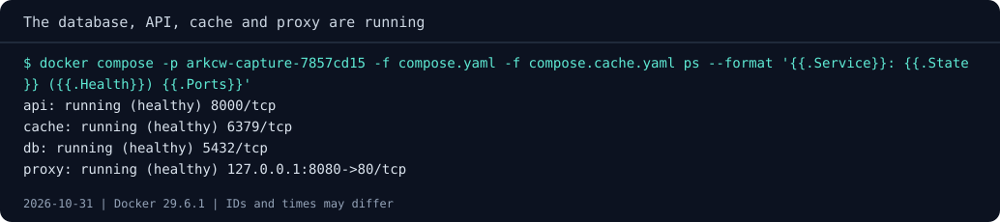

# Troubleshooting and handover

Your colleague reports that the reading-list page opens, but saving a book
fails. We have several boundaries to investigate: the browser-to-proxy route,
the proxy-to-API connection, and the API-to-database operation. A useful
handover helps them distinguish these failures before proposing a restart.

Use the cache-enabled project in `application`, with Watch stopped after
chapter 5. From a fresh checkout, follow the [module setup](README.md) and
start the base and cache files with `up -d --build --wait`, then add a book.
Keep its title and ID as recovery evidence.

Before introducing a fault, keep a snapshot of the four-service stack for
comparison. `ps` shows which services are running and what their configured
healthchecks reported at that moment; the HTTP checks below will help us
verify the request path too.



## Let the response narrow the search

Start with three HTTP observations. The root path tests static UI delivery,
`/api/ready` tests the API's database check through the proxy, and
`/api/missing` asks for an intentionally unknown API route:

=== "Linux (Bash)"

    ```bash
    curl -i http://127.0.0.1:8080/
    curl -i http://127.0.0.1:8080/api/ready
    curl -i http://127.0.0.1:8080/api/missing
    ```

=== "Windows (PowerShell)"

    ```powershell
    curl.exe -i http://127.0.0.1:8080/
    curl.exe -i http://127.0.0.1:8080/api/ready
    curl.exe -i http://127.0.0.1:8080/api/missing
    ```

Expect HTML at `/`, readiness JSON with HTTP 200, and JSON `route not found`
with HTTP 404 for the missing route. That last response came from the API:
a request can be successfully proxied and still target an invalid
application path. A proxy connection failure commonly yields an Nginx HTML
502, or 504 when the upstream connection times out, while the API's dependency
failure is JSON 503. Preserve response body,
status and selected logs together instead of diagnosing from a status alone.

Open `proxy/default.conf` and follow the two trailing slashes:
`location /api/` and `proxy_pass http://reading_api/`. This form replaces
the matching `/api/` prefix with `/`, so `/api/books` reaches `/books`.
The upstream name is a configured Nginx group whose server uses Compose's
`api` DNS name.

## Introduce a path fault, then verify the repair

Keep a copy of the original setting in your editor. Remove only the trailing
slash from `proxy_pass http://reading_api/;`, making it
`proxy_pass http://reading_api;`. Rebuild the proxy and request the list:

```text
docker compose -p ark-reading -f compose.yaml -f compose.cache.yaml up -d --build --wait proxy
docker compose -p ark-reading -f compose.yaml -f compose.cache.yaml logs --tail 20 proxy api
```

Use curl on `/api/books` again. The path now arrives at the API as
`/api/books`, which its routes do not recognize, so expect API JSON 404.
The UI may load while its record request fails. Before changing anything
else, say which observation rules out “the API never received the request.”

Restore the trailing slash in the source, rebuild the proxy with the same
command, and verify the saved title through `/api/books`. Rebuilding matters:
the runtime proxy uses configuration copied into its image, not a host
configuration mount.

## Separate a stopped API from a stopped database

Stop the API and request `/api/books`. The proxy is still running and its
static UI can still load, but its upstream connection cannot succeed.
Collect that response before starting the API again:

```text
docker compose -p ark-reading -f compose.yaml -f compose.cache.yaml stop api
```

=== "Linux (Bash)"

    ```bash
    curl -i http://127.0.0.1:8080/
    curl -i http://127.0.0.1:8080/api/books
    ```

=== "Windows (PowerShell)"

    ```powershell
    curl.exe -i http://127.0.0.1:8080/
    curl.exe -i http://127.0.0.1:8080/api/books
    ```

Inspect the proxy's upstream error, then start the API and wait for its
readiness condition. Repeat the record request after recovery:

```text
docker compose -p ark-reading -f compose.yaml -f compose.cache.yaml logs --tail 20 proxy
docker compose -p ark-reading -f compose.yaml -f compose.cache.yaml start api
docker compose -p ark-reading -f compose.yaml -f compose.cache.yaml ps
```

Now repeat with only `db` stopped, as in chapter 2, collecting the response
and API logs before starting it again. Expect the API's explicit JSON 503
rather than an upstream connection response. Remember that health reports
a condition; it does not continuously repair a broken dependency.

For replacement rather than restart, recreate only the API and verify both
records and route recovery:

```text
docker compose -p ark-reading -f compose.yaml -f compose.cache.yaml up -d --force-recreate --wait api
```

Nginx's documented dynamic upstream resolution keeps `api` discoverable
after address changes. An unchanged address on your engine is possible,
so a successful recreation alone is weaker evidence of DNS refresh than a
replacement whose address actually changed.

## Write the runbook someone else needs

Choose a colleague or your future self as the audience and prepare a short
local handover. Include the checkout location, Docker/Compose prerequisites,
project name and port, selected image versions and the limitations of the
dummy credential. Explain how they create their own ignored secret file;
share the example, never a genuine credential.

Your runbook should let them:

- start the base or cache model and verify UI plus API records;
- select development mode, stop Watch, and rebuild chosen source changes;
- distinguish static delivery, route mismatch, upstream connection and
  database failure using HTTP responses and logs;
- back up the source database and restore into a **distinct empty project**,
  comparing records through the API;
- stop or remove only their project, preserving its named volume unless
  they explicitly intend to discard its records.

State which data your backup captured and how you verified recovery, rather
than listing a filename as proof. Document that API counters reset on
restart, Redis is disposable, and the database volume is not a backup.
Ask a peer to follow the runbook with project `ark-reading-peer` on 8081,
or do the same yourself in a separate project and record unclear steps.

Before sharing the fixture, inspect its Git diff and Docker build context.
Ignored credentials and backups belong outside the handover; package
retrieval still requires internet, and these source-build commands are
not a test on a cold second machine unless someone actually performs it.

## Close the experiment without touching the rest of Docker

If you want to pause, use `stop`. To remove only this project's containers
and networks while retaining records:

```text
docker compose -p ark-reading -f compose.yaml -f compose.cache.yaml down
```

Add `--volumes` only when you deliberately want to erase this project's
reading list. Avoid global prune commands: another person may own resources
on the same engine. Keep a host backup before discarding records you care
about, and confirm the project name in every destructive command.

You now have a complete operating cycle to explain, from first request to
recovery and development. Take the [kata](katas/README.md) with less supplied
configuration, then revisit the [self-checks](check-your-understanding.md)
after a few days without reopening these chapters first.

For deeper routing details, consult Nginx's
[proxy_pass reference](https://nginx.org/en/docs/http/ngx_http_proxy_module.html#proxy_pass)
and [upstream resolve and resolver directives](https://nginx.org/en/docs/http/ngx_http_upstream_module.html).
