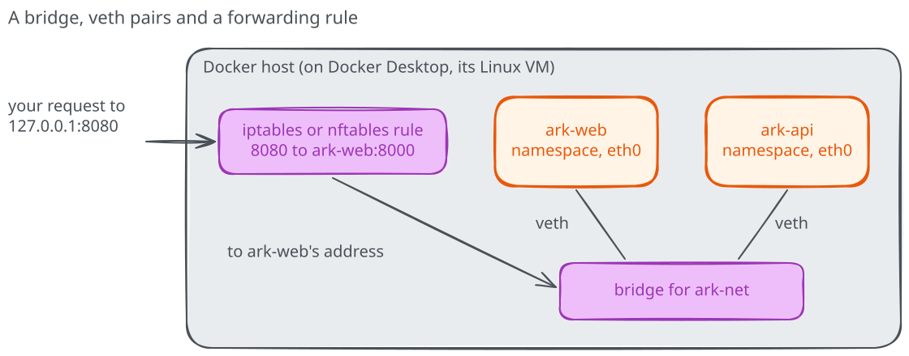

# Bridges, ports and network drivers

In the core module we described `ark-net` as a small office network: each
container has a network card, a switch connects them, and a published port is
a door from your computer. That picture is enough to connect and diagnose
services. Here we'll check what each part of it really is, and meet the
network types the core module left out.

## Start from the running stack

Recreate the stack from module 06 if you removed it. From
`06-networking/network-service`, with the `ark-network:v1` image built:

=== "Linux (Bash)"

    ```bash
    docker network create ark-net
    docker run -d --name ark-api --network ark-net ark-network:v1
    docker run -d --name ark-web --network ark-net -p 127.0.0.1:8080:8000 \
      -e BACKEND_URL=http://ark-api:8000/health \
      ark-network:v1 python /app/web.py
    ```

=== "Windows (PowerShell)"

    ```powershell
    docker network create ark-net
    docker run -d --name ark-api --network ark-net ark-network:v1
    docker run -d --name ark-web --network ark-net -p 127.0.0.1:8080:8000 `
      -e BACKEND_URL=http://ark-api:8000/health `
      ark-network:v1 python /app/web.py
    ```

## The network card is half of a cable

Look at the interfaces the frontend sees:

```text
docker exec ark-web ip addr
```

There are two: `lo`, the loopback interface every Linux system has, and
`eth0`, with the address Docker gave the container on `ark-net`. The name
`eth0@if...` hints at what it is. The container runs in its own **network
namespace**, a separate copy of the kernel's network stack with its own
interfaces, addresses, routes and ports. That's the real reason two
containers can both listen on port `8000`: the ports live in different
namespaces.

`eth0` is one end of a **veth pair**, a virtual cable with two ends. Docker
places one end inside the container's namespace and plugs the other into a
Linux **bridge**, a software switch on the Docker host. Every container on
`ark-net` hangs off the same bridge, so their traffic can reach each other.
The [namespaces chapter](../linux-primitives/02-namespaces.md) shows the same
mechanism from the kernel's side.

On a Linux Docker Engine host you can see the other end. `ip link` on the
host lists a `br-` interface for `ark-net` and one `veth` interface per
attached container. On Docker Desktop, the bridge lives inside Desktop's
Linux virtual machine, so it doesn't show up on your computer. Don't change
those interfaces by hand: Docker owns them.

Ask Docker how it describes the network:

```text
docker network inspect --format '{{.Driver}} {{json .IPAM.Config}}' ark-net
```

The driver is `bridge`, and the configuration shows the subnet Docker chose
for `ark-net`. Each network you create gets its own bridge and subnet, which
is how two stacks on the same host stay separate.

## A published port is a forwarding rule

The frontend's port `8000` lives in its namespace, and nothing on your
computer can open it directly. Publishing with `-p 127.0.0.1:8080:8000` asks
Docker to forward traffic. On Linux, Docker writes packet-filtering rules,
with `iptables` or `nftables` depending on its configuration, that rewrite
the destination of incoming packets to the container's address and port. In
some cases it also runs a small helper process, `docker-proxy`, that relays
the connection.

On Docker Desktop there's one more hop: Desktop listens on your computer's
port and forwards the traffic into its virtual machine, where the same kind
of rules deliver it to the container. That's why `127.0.0.1:8080` works on
Windows and macOS even though the containers run in Linux.

Containers on the same network don't use any of this. `ark-web` reaches
`ark-api:8000` straight across the bridge, which is why the API needs no
published port.



## Why the default bridge didn't resolve names

Docker creates three networks when it starts. List them:

```text
docker network ls
```

Next to `ark-net` you'll find `bridge`, `host` and `none`. `bridge` is the
**default bridge**, used by every container started without `--network`. It
predates the networks you create yourself and keeps their older behavior.
Containers on it get the host's DNS settings instead of Docker's name server
at `127.0.0.11`, so they can only reach each other by IP address. Every
container without a network choice also lands there, unrelated ones
included. **For services that talk to each other, always create a network.**
The default bridge is fine for a single container that only needs a
published port.

## The other network types

Run a container on the `none` network and look at its interfaces:

```text
docker run --rm --network none ark-network:v1 ip addr
```

Only `lo` is left. The container has a network namespace with no way out,
which suits a job that should never talk to anything: processing local
files, say. Any attempt to call a service fails.

The `host` network goes the other way. A container started with
`--network host` doesn't get its own namespace: it shares the host's, so a
program listening on port `8000` listens on the host's port `8000`, and
`-p` is ignored. That avoids the forwarding step and helps with programs
that open many ports, but two containers can no longer use the same port,
and the separation you saw above disappears. Docker Engine on Linux supports
it directly; Docker Desktop supports it from version 4.34 after you enable it
in its settings, and only for TCP and UDP. **When to use it: rarely, and for
a reason you can name.**

A few more drivers serve setups beyond one host:

| Driver | What it does | Where you'll meet it |
|---|---|---|
| `overlay` | Joins containers on several Docker hosts into one network | Docker Swarm |
| `macvlan`, `ipvlan` | Gives containers addresses on your physical network | Appliances and legacy systems expecting a LAN address |
| CNI plugins | Kubernetes' equivalent of Docker's network drivers | Kubernetes clusters |

They solve real problems, but a user-defined bridge covers everything a
single-host stack like ours needs.

## Return to the service

Make a prediction before you check it: if you start a third container from
`ark-network:v1` on the default network and call `ark-api` from it, what
happens? And from a container on `ark-net`?

```text
docker run --rm ark-network:v1 python -c "import socket; print(socket.gethostbyname('ark-api'))"
docker run --rm --network ark-net ark-network:v1 python -c "import socket; print(socket.gethostbyname('ark-api'))"
```

The first fails with a name resolution error, because the default bridge has
no name server for containers. The second prints the API's address on
`ark-net`. Clean up when you're done:

```text
docker rm -f ark-web ark-api
docker network rm ark-net
```
