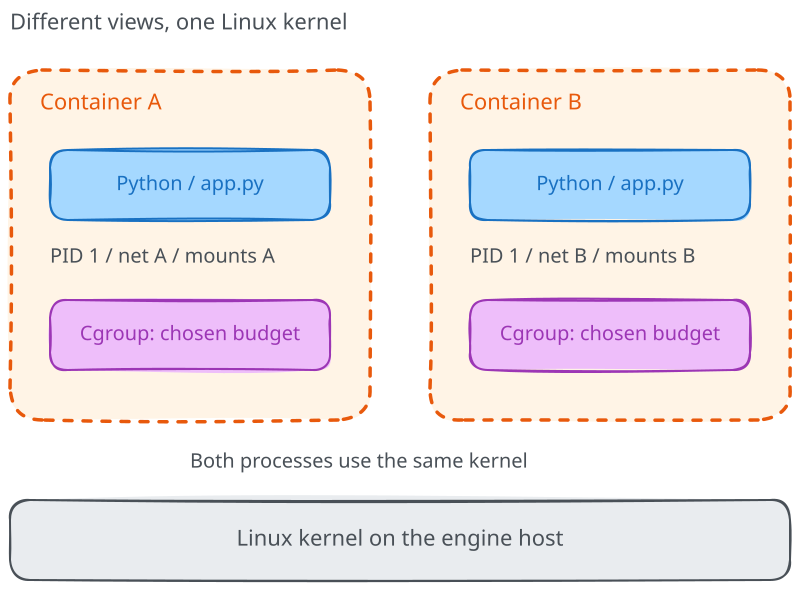

# A container is just a process

> **Under the hood: optional advanced material.** This deep dive is not
> required for the core course or its final project.
> [About these deep dives](../README.md).

You started two copies of the message service, and both believed they had port
8000 to themselves. Neither booted a machine, and neither installed a kernel.
So what exactly did Docker create?

Let's start with something less mysterious than the word *container*: a Linux
process. By the end of this module, you'll be able to connect that process to
its namespaces, resource controls and filesystem, then explain which of those
mechanisms mattered in our first application.

## Start with the process you already know

A process is a running instance of a program, with an address space, credentials,
open files and an identity the kernel can schedule. When Python accepts our HTTP
request, it asks the Linux kernel to do things such as read a file, accept a
connection or allocate memory. The image supplied Python's executable and
userspace libraries; it did not supply the kernel answering those requests.

That is true even when the laptop itself runs Windows or macOS. With Linux
containers on Docker Desktop, the relevant kernel is inside Docker's Linux VM.
Your laptop, the Docker engine host and the container are therefore not always
three names for the same environment. Keep that distinction nearby: it prevents
quite a few confusing afternoons.



## Same work, different views

Ordinary processes already have separate virtual address spaces. Containers add
other boundaries around them rather than inventing a different kind of
executable. A **PID namespace** changes which processes they can identify; a
**network namespace** gives them their own network stack; a **mount namespace**
lets them see a different mount layout.

Docker also arranges a root filesystem, chooses credentials, applies security
policy and places the process in a resource-management group. Not every one of
these settings must be unique for every container. You can deliberately share
some namespaces, and a container without explicit resource limits may compete
for much more host capacity than you intended.

This is why "isolated process" is useful but incomplete. We need to ask:
isolated from what, using which mechanism, and with which configuration?

## One process, more than one PID

Suppose Python is PID 1 inside its container. The engine host might identify
that same process as PID 27341. There aren't two copies of Python here: a
process in a nested PID namespace has identifiers in that namespace and its
ancestor namespaces.

The host can observe a process that the container cannot see in return. Within
the container, `/proc` normally presents the process view associated with its
PID namespace. The host's `/proc` presents the host view. Comparing numbers
without first checking which view you're using is not particularly useful.

You can ask Docker for both kinds of evidence:

```bash
docker top ark-message
docker inspect --format '{{.State.Pid}}' ark-message
```

These commands require the service from module 01 to be running. `docker top`
reports processes from the engine's perspective; the PID in `inspect` belongs
to the engine host, not necessarily your current shell's host. On Desktop, do
not feed that number into your WSL distribution's `/proc` and assume it is the
same process.

The [inspection lab](06-inspecting-namespaces-and-cgroups.md) supplies a fresh,
bounded example if you already cleaned up the application.

## Where the VM comparison helps

A VM runs a guest kernel, usually backed by a hypervisor. Two containers on
the same Linux engine normally ask the same kernel to enforce their boundaries.
Different image distributions do not change that: an Alpine userspace and an
Ubuntu userspace can both make requests to the same host kernel.

Sharing that kernel removes the need to boot one per application, but it also
shares a failure and attack boundary. A vulnerable kernel does not become safe
because the image has a different `/etc/os-release`. Conversely, putting a
process in a VM doesn't remove the need for application permissions, limits
and updates.

## Follow a request back to the host

Think about the first service again. The incoming request reached a published
host port, crossed into the container's network context, and was handled by
Python. Python read the message from its environment and wrote JSON back to a
socket. The kernel performed the networking and scheduling.

The hostname in the JSON was a view the process received, not evidence that it
owned a machine. The Python version came from the image, while the source code
was a bind-mounted host file. Those are different kinds of dependency, even
though they appeared together inside the running application.

Before moving on, explain what would change if we replaced the image's Python
version. Would that also replace the kernel? What would change if we moved the
container to another Linux engine host?

Next, [namespaces](02-namespaces.md) explain why two ordinary processes can have
such different views of the same system.

## Further reading

- [Linux namespaces overview](https://man7.org/linux/man-pages/man7/namespaces.7.html)
- [Docker security model](https://docs.docker.com/engine/security/)
