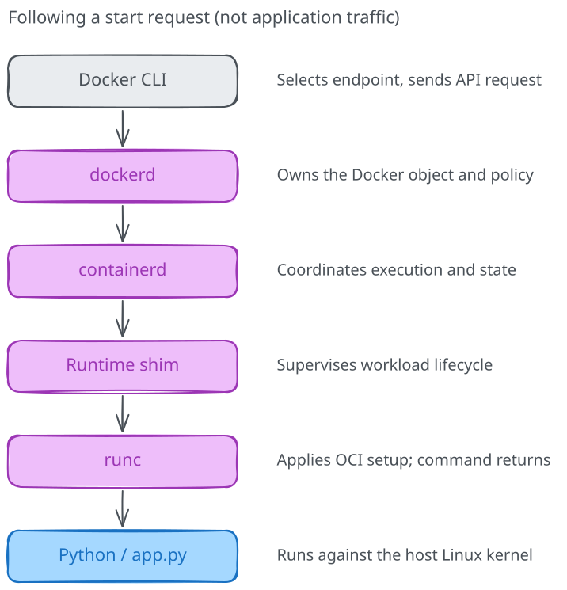

# The Docker engine

> **Under the hood: optional advanced material.** This deep dive is not
> required for the core course or its final project.
> [About these deep dives](../README.md).

You typed `docker run`, and a service appeared. The CLI didn't personally
create a namespace, mount the image or schedule Python on a CPU. It sent a
request to a service that coordinated that work.

Now that the Linux mechanisms have names, let's follow the request and connect
them to the tools. We'll use the same message service, not a second application
you have to learn before understanding the first one.

## The client isn't the engine

The `docker` command is a client of the Docker Engine API. The engine's daemon,
`dockerd`, owns Docker's model of images, containers, networks and volumes, and
coordinates operations on them. A local command commonly talks through a Unix
socket or a Desktop-managed endpoint; a context can select a remote engine.

That means the directory used in a bind mount must be available to the **engine
host**, subject to Desktop's file-sharing integration. Pointing a local client
at a remote server doesn't transfer every file mentioned in a mount argument.
Our first lab assumed a local Engine or integrated Desktop environment.



The diagram is a responsibility map, not a claim that every HTTP request passes
through those components. Once Python is listening, application traffic follows
the configured network path; it doesn't traverse the Docker CLI.

## Find the engine you are actually using

```bash
docker context show
docker context inspect
docker version
docker info
```

In `docker version`, distinguish Client from Server. A working client binary
doesn't establish that the server is reachable. Environment variables such as
`DOCKER_HOST` or `DOCKER_CONTEXT` can also affect endpoint selection; inspect
them if the command reaches a different engine than expected.

Access to a rootful Docker API is powerful. A user who can ask the daemon to
create arbitrary mounts and privileged workloads can usually gain host-level
control. Don't expose an unauthenticated TCP daemon or pass its socket into an
application just to make a diagnostic command convenient.

## Follow our service through create and start

Use the Bash setup from module 01 and Linux containers. In a rootful native
setup, prefix Docker commands with `sudo`. From the course checkout root:

```bash
cd 01-why-containers/first-app
docker ps -a --filter name=ark-runtime-message
```

Proceed only if that exact name is free or belongs to your own previous lab
attempt. Port 8088 must also be free on loopback.

```bash
docker create --name ark-runtime-message \
  --user 65534:65534 --cap-drop ALL \
  --security-opt no-new-privileges=true \
  --memory 64m --memory-swap 64m --pids-limit 32 \
  --mount "type=bind,source=$(pwd)/app.py,target=/app/app.py,readonly" \
  -e MESSAGE="Following the runtime" \
  -p 127.0.0.1:8088:8000 \
  docker.io/library/python:3.12-alpine python -u /app/app.py
docker inspect --format 'status={{.State.Status}} pid={{.State.Pid}} image={{.Image}}' \
  ark-runtime-message
```

The object exists, but Python hasn't started. Expect status `created` and PID
`0`. `docker run` normally combines this creation step with starting the object
and optionally attaching to it.

In another terminal on the same Docker context, watch only this container:

```bash
docker events --filter container=ark-runtime-message
```

Back in the first terminal:

```bash
docker start ark-runtime-message
docker logs ark-runtime-message
docker inspect --format 'status={{.State.Status}} pid={{.State.Pid}}' ark-runtime-message
docker top ark-runtime-message
```

Wait for the listening message before opening `http://127.0.0.1:8088/` and
`http://127.0.0.1:8088/health`. On a remote VM, check from that VM or use an SSH
tunnel; loopback belongs to the engine host. Expect the configured message and
a healthy response. If the service exits, inspect its state and logs.

## Execution is delegated, ownership remains

For the standard Linux execution path, dockerd asks containerd to manage
execution-related state. Containerd uses a runtime shim and a configured
low-level runtime such as runc to create the process with its Linux settings.
The next chapters unpack those jobs.

Docker still owns the higher-level object you created. A containerd operation
isn't a safe substitute for a Docker API operation on a Docker-managed
container. Otherwise, different managers can disagree about what exists.

You can ask Docker to start another process in the same container:

```bash
docker exec ark-runtime-message python -c \
  'import os, platform; print("exec PID:", os.getpid()); print("kernel:", platform.release())'
```

This is not a new image or a second boot. It is an additional process placed
in the existing container environment. Inspecting its PID doesn't reveal the
entire engine-host process tree.

## Stop the process, then remove the object

```bash
docker stop ark-runtime-message
docker inspect --format 'status={{.State.Status}} pid={{.State.Pid}} exit={{.State.ExitCode}}' \
  ark-runtime-message
docker rm ark-runtime-message
```

Observe the stop and removal events, then stop only your `docker events` client
with Ctrl+C. Event details vary with the engine and request sequence; don't
expect one fixed line per conceptual layer.

Stopping left the Docker object available for inspection and restart. Removal
deleted that object and its writable layer; the host source file and downloaded
image remain. Our supplied server doesn't install a graceful shutdown handler,
so don't treat this exercise as proof of application-level graceful shutdown.

Before moving on, explain three different failures: the CLI cannot reach the
engine, the engine cannot prepare a mount, and Python starts but exits with an
application error. Which of them could produce useful Python logs?

Next, [containerd and the shim](02-containerd-and-the-shim.md).

## Further reading

- [Docker overview](https://docs.docker.com/get-started/docker-overview/)
- [Docker contexts](https://docs.docker.com/engine/manage-resources/contexts/)
- [Docker daemon attack surface](https://docs.docker.com/engine/security/)
