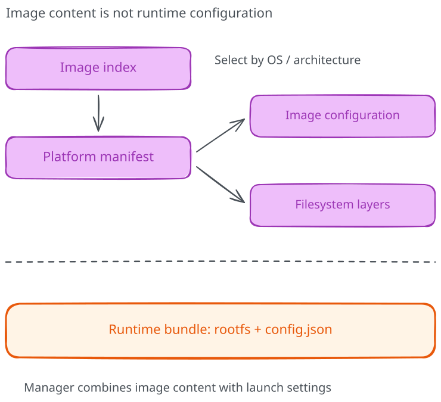

# OCI image and distribution specs

We have a contract for starting a prepared filesystem. But where did that
filesystem come from, and why can different tools retrieve the same image?
Those are separate questions, covered by separate specifications.

The OCI project defines runtime, image and distribution specifications. They
fit together, but treating them as one giant "container standard" hides the
boundary that's useful when something fails.

## Three contracts, three questions

| Contract | Question it answers |
|----------|---------------------|
| Runtime | How is a prepared container configured and executed? |
| Image | How are image content and configuration described? |
| Distribution | How do clients transfer content through a registry API? |

None of these is a course application API. Our `/health` endpoint still belongs
to our Python service. A compliant image can contain a broken program, and a
successful image pull cannot prove that the program is ready to serve requests.



## An image is a graph of addressed content

A platform-specific **manifest** references a configuration object and ordered
filesystem layers. Those references include media types, sizes and digests.
The configuration describes information such as the target platform and default
execution settings; the layers describe filesystem changes.

An **image index** can point to multiple manifests, commonly one per supported
platform. A client on amd64 and a client on arm64 can resolve the same tag to
different platform manifests. That is normal selection behavior, not proof
that one of the clients downloaded the wrong file.

A digest identifies the bytes of a particular object. A tag is a registry name
that can be updated to reference different content. Which object a digest
identifies matters: an index digest and a platform-manifest digest are not
interchangeable descriptions of the same byte sequence.

## Inspect the runtime image

These are read-only inspections after a pull, with no container or volume
created. Use the same Docker context as your previous labs:

```bash
docker pull docker.io/library/python:3.12-alpine
docker image inspect docker.io/library/python:3.12-alpine --format \
  'id={{.Id}} platform={{.Os}}/{{.Architecture}} digests={{json .RepoDigests}}'
docker manifest inspect docker.io/library/python:3.12-alpine
```

The first inspection describes Docker's local image view. For ordinary images,
the image ID identifies the configuration object; do not casually relabel it
as the registry manifest digest. `RepoDigests` records repository digest
references known to the engine and can depend on how content was acquired.

`docker manifest inspect` contacts the registry and may show an index or
manifest list with several platform entries. Modern indexes can also include
attestation-related entries; not every descriptor represents a runnable
application platform. Record the actual media type and platform fields instead
of expecting one fixed JSON document.

These commands use a moving tag, so results can change between runs. Keep the
observed references in your notes if you want to compare later. Module 03 will
turn that observation into an artifact-delivery workflow.

## Distribution moves content, not running containers

A registry stores and serves manifests and blobs. The distribution API defines
operations for retrieving and publishing that content, along with naming and
content-addressing behavior. Authentication and authorization remain part of
the actual registry deployment and client interaction.

An engine must still verify retrieved content, select the platform, unpack
layers through its storage machinery and prepare runtime configuration.
A registry doesn't allocate the container's PID namespace or start Python.

This separation gives us useful diagnostic questions. A registry authentication
failure happens before runtime execution. A missing executable happens after
content selection and filesystem preparation. A healthy pull followed by a
failing `/health` route points us somewhere else again.

## Compatible doesn't mean identical

OCI and Docker image formats share much of their practical ecosystem, but
media types and supported features still matter. A tool accepting an image
doesn't mean it supports every annotation, artifact type, runtime option or
build extension another tool can produce.

Nor does a digest guarantee a secure application. Content identity answers
"which bytes?", not "are these bytes trustworthy?" Provenance, signatures,
vulnerability assessment and runtime policy answer additional questions.

Before continuing, explain why two colleagues can report the same tag while
running different platform content. Then distinguish an image configuration,
a distribution manifest and a runtime bundle's `config.json`. They are all
configuration-related objects, but they do different jobs.

Next, [CRI and the wider ecosystem](05-cri-and-the-wider-ecosystem.md).

If you opened this explanation from the core course, return to
[tags, digests and manifests](../../03-images-and-registries/03-digests-manifests-and-multi-arch-images.md)
and label the identities in your handover. Continuing through the rest of this
deep dive is optional.

## Further reading

- [OCI image specification](https://github.com/opencontainers/image-spec)
- [OCI distribution specification](https://github.com/opencontainers/distribution-spec)
- [Docker image inspection](https://docs.docker.com/reference/cli/docker/image/inspect/)
